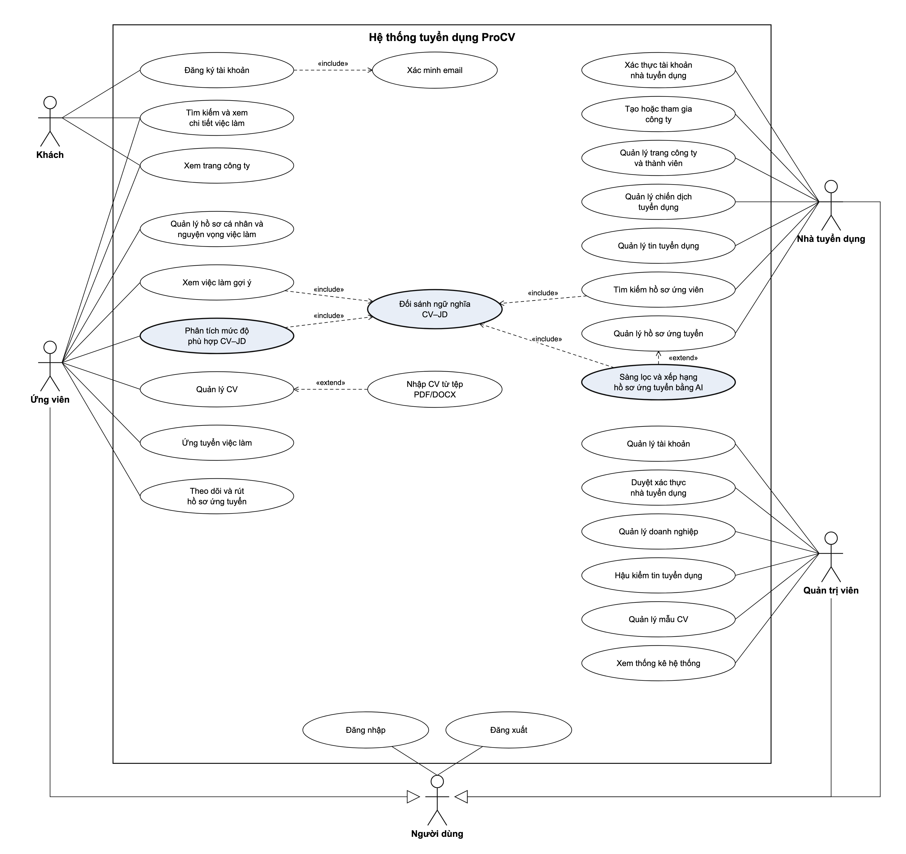
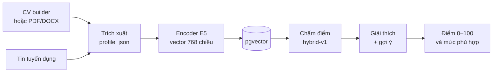
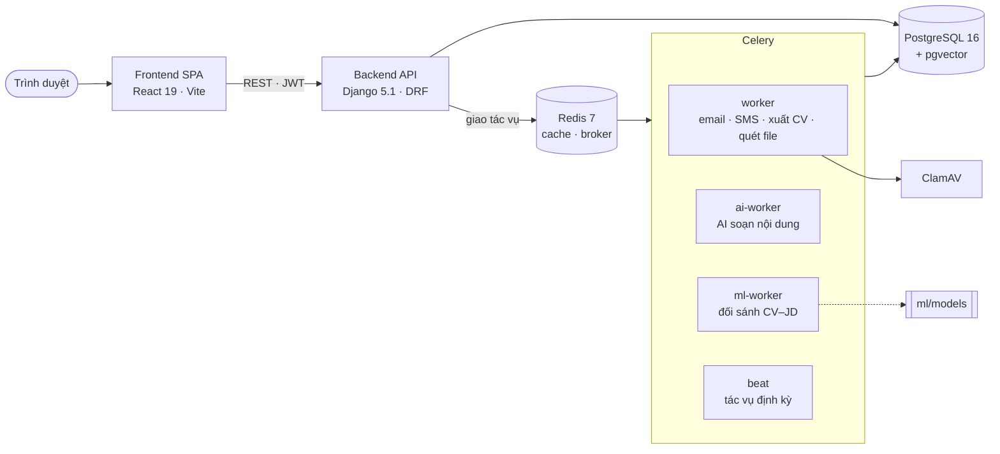

<div align="center">


### Nền tảng tuyển dụng tích hợp AI đối sánh CV–JD

Kết nối ứng viên và nhà tuyển dụng: tạo CV theo mẫu, đăng tin, quản lý chiến dịch
và chấm độ phù hợp CV–tin tuyển dụng bằng mô hình ngôn ngữ chạy local.

[](https://github.com/VanhauDAU/ai-recruitment-platform/actions/workflows/backend-ci.yml)
[](https://github.com/VanhauDAU/ai-recruitment-platform/actions/workflows/frontend-ci.yml)
[](https://github.com/VanhauDAU/ai-recruitment-platform/actions/workflows/docs-ci.yml)


[Tính năng](#tính-năng) · [AI đối sánh](#ai-đối-sánh-cvjd) · [Kiến trúc](#kiến-trúc) ·
[Bắt đầu nhanh](#bắt-đầu-nhanh) · [Kiểm thử](#kiểm-thử-và-chất-lượng) · [Tài liệu](#tài-liệu)

</div>

---

## Giới thiệu

**ProCV** là đồ án tốt nghiệp ngành Công nghệ thông tin. Hệ thống gồm ba cổng
độc lập trên cùng một nền tảng:

| Cổng | Đường dẫn | Dành cho |
| --- | --- | --- |
| 🎯 **Ứng viên** | `/` | Tìm việc, tạo và quản lý CV, ứng tuyển, xem độ phù hợp với tin |
| 🏢 **Nhà tuyển dụng** | `/tuyendung` (giới thiệu) · `/tuyendung/app` (workspace) | Xác thực doanh nghiệp, trang công ty, chiến dịch, tin tuyển dụng, xử lý hồ sơ |
| 🛡️ **Quản trị** | `/quan-tri` | Duyệt xác thực, hậu kiểm tin, quản lý tài khoản, nội dung và cấu hình |

Mỗi cổng là một tài khoản riêng: cùng một email có thể có một tài khoản ứng viên
và một tài khoản nhà tuyển dụng, mật khẩu và phiên đăng nhập tách biệt.

<details>
<summary><b>Sơ đồ use case tổng quát</b></summary>
<br>

</details>

## Tính năng

### 🎯 Ứng viên

- **Tài khoản**: đăng ký bằng email (có xác minh) hoặc Google, Facebook, LinkedIn;
  onboarding khai báo nhu cầu việc làm; quản lý phiên theo thiết bị.
- **Tìm việc**: lọc theo danh mục ngành 3 cấp, địa điểm (34 tỉnh/thành, 3.321
  xã/phường), mức lương, cấp bậc, hình thức; tìm kiếm tiếng Việt không dấu;
  lưu tin, ẩn tin, nhận email gợi ý việc làm.
- **CV**: trình soạn CV theo 10 mẫu (tự lưu nháp, phiên bản, xuất PDF), nhập CV có
  sẵn từ PDF/DOCX, điểm hoàn thiện CV; tệp tải lên được quét mã độc trước khi dùng.
- **Ứng tuyển**: nộp bằng CV tạo trên hệ thống hoặc CV tải lên, theo dõi trạng
  thái, rút hồ sơ, xem lịch sử các lần nộp.
- **AI**: "Xem độ phù hợp" với từng tin: điểm tổng, điểm từng tiêu chí, kỹ năng
  khớp/thiếu kèm câu trích dẫn từ CV và gợi ý cải thiện.
- **Nội dung**: trang công ty, danh bạ công ty, cẩm nang nghề nghiệp, trung tâm
  trợ giúp.

### 🏢 Nhà tuyển dụng

- **Xác thực**: xác minh email và số điện thoại (OTP), nộp giấy tờ doanh nghiệp,
  chấp nhận thỏa thuận xử lý dữ liệu (DPA); công ty có nhiều thành viên, chủ sở
  hữu duyệt người xin tham gia.
- **Trang công ty**: tự biên tập nội dung, đăng ngay rồi hậu kiểm.
- **Chiến dịch tuyển dụng**: một đợt tuyển nhiều vị trí, mục tiêu và vòng đời
  theo lịch; phân phối đa kênh bằng link theo dõi nguồn, đăng lên Facebook Page;
  chỉ số sức khỏe chiến dịch.
- **Tin tuyển dụng**: có cấu trúc (lương, địa điểm, ca làm, quyền lợi, ngoại ngữ,
  kỹ năng), AI soạn bản nháp, đăng ngay khi đủ điều kiện.
- **Hồ sơ ứng tuyển**: workspace theo pipeline, mời người đánh giá bằng link
  bảo mật kèm phiếu chấm, kho ứng viên tiềm năng, danh sách chặn, nhắc việc.
- **Song ngữ**: toàn bộ cổng nhà tuyển dụng có tiếng Việt và tiếng Anh, email và
  thông báo theo ngôn ngữ người nhận.

### 🛡️ Quản trị

- Bảng điều khiển với hàng chờ xử lý, KPI so kỳ trước và xu hướng.
- Duyệt xác thực nhà tuyển dụng, yêu cầu cập nhật công ty, hậu kiểm tin và nội
  dung trang công ty; xử lý báo cáo vi phạm.
- Quản lý tài khoản (khóa, cấm, thu hồi phiên) với nhật ký hoạt động theo nhóm.
- Quản lý mẫu CV, blog, trung tâm trợ giúp, thông báo đa cổng và 17 nhóm cấu hình
  website không cần sửa code.
- Hai cấp quyền: quản trị viên và superuser; mọi thao tác được ghi audit.

## AI đối sánh CV–JD

Lõi AI của đồ án chấm mức độ phù hợp giữa CV và tin tuyển dụng. Mô hình
[`intfloat/multilingual-e5-base`](https://huggingface.co/intfloat/multilingual-e5-base)
chạy và fine-tune **hoàn toàn trên máy local**, không gửi dữ liệu ứng viên ra
dịch vụ bên ngoài.



Công thức `hybrid-v1` gồm 6 tiêu chí; tiêu chí thiếu dữ liệu bị loại và trọng số
được chuẩn hóa lại:

| Tiêu chí | Trọng số | Cách chấm (tóm tắt) |
| --- | ---: | --- |
| Kỹ năng | 0,40 | Khớp theo danh mục kỹ năng hoặc theo ngữ nghĩa, phải có câu bằng chứng trong CV |
| Kinh nghiệm | 0,30 | Số năm kết hợp mức liên quan ngữ nghĩa giữa CV và tin |
| Học vấn | 0,10 | So bậc học với yêu cầu |
| Cấp bậc | 0,10 | Độ lệch cấp bậc |
| Ngoại ngữ | 0,10 | So trình độ với yêu cầu; thiếu ngoại ngữ bắt buộc thì điểm tổng tối đa 64 |
| Địa điểm | 0,10 | Cùng tỉnh hoặc làm từ xa |

Mức kết quả: **≥ 80** Rất phù hợp · **65–79** Phù hợp · **50–64** Tương đối phù
hợp · **< 50** Chưa phù hợp. Kết quả tất định, không bịa kỹ năng: mọi kỹ năng
khớp đều kèm câu trích nguyên văn từ CV.

Dữ liệu, script huấn luyện và đánh giá nằm trong [`ml/`](ml/README.md); thuật
toán chi tiết ở [`thuat-toan-ai.md`](docs/07-algorithms/thuat-toan-ai.md).

## Kiến trúc



- **Backend** chia theo app nghiệp vụ trong `backend/apps/`, mỗi app cùng một bố
  cục `api → services/selectors → models → domain`, được `import-linter` kiểm tra
  ([ADR-0022](docs/adr/adr-0022-backend-structure.md)).
- **Frontend** theo Feature-Sliced Design rút gọn
  `app → pages → widgets → features → entities → shared`, tách theo cổng
  ([`frontend/ARCHITECTURE.md`](frontend/ARCHITECTURE.md)).
- **Tác vụ nền** chạy trên Celery với outbox lưu trong DB; request web không chờ
  dịch vụ bên ngoài.

## Công nghệ

| Lớp | Công nghệ |
| --- | --- |
| Frontend | React 19, Vite 8, React Router 8, TanStack Query 5, Ant Design 6, Tailwind CSS 4, Paraglide (i18n) |
| Backend | Python 3.11, Django 5.1, Django REST Framework, SimpleJWT, drf-spectacular (OpenAPI), Celery 5 |
| Dữ liệu | PostgreSQL 16 + pgvector, Redis 7, lưu file local hoặc Cloudflare R2 |
| AI / ML | sentence-transformers, PyTorch, multilingual-e5-base; pypdfium2, python-docx; Google Gen AI cho soạn nội dung |
| Tài liệu PDF | Playwright Chromium (xuất CV), pypdfium2 (ảnh xem trước) |
| Bảo mật file | Upload qua vùng cách ly, quét ClamAV |
| Kiểm thử | pytest, Vitest, Playwright E2E |
| Chất lượng | Ruff, import-linter, oxlint, dependency-cruiser, pre-commit |
| Hạ tầng | Docker Compose, GitHub Actions |

## Cấu trúc thư mục

```text
ai-recruitment-platform/
├── backend/            Django API
│   ├── config/         settings, urls, Celery
│   ├── common/         hạ tầng dùng chung, không biết nghiệp vụ
│   └── apps/           accounts, candidates, employers, campaigns, jobs,
│                       applications, cvs, cv_templates, matching, ai_core,
│                       uploads, privacy, sitecontent, knowledgebase, blog,
│                       dashboard, skills, locations, messaging, realtime
├── frontend/           React SPA
│   ├── src/            app · pages · widgets · features · entities · shared
│   ├── messages/       chuỗi giao diện vi/en
│   └── tests/e2e/      Playwright
├── ml/                 dữ liệu, huấn luyện và đánh giá mô hình đối sánh
├── docs/               tài liệu phân tích, kiến trúc, ADR, API, hướng dẫn
├── scripts/            check_*: cổng chất lượng (CI và check_all.sh)
│   │                   bootstrap_backend, reset_local_db, clean_artifacts: máy dev
│   ├── ci/             tiện ích riêng của GitHub Actions
│   ├── deploy/         lệnh chạy trên VPS: deploy, sao lưu, khôi phục
│   └── loadtest/       kịch bản k6
├── deploy/certs/       chứng chỉ origin trên VPS (không commit)
├── docker-compose.yml  môi trường dev
└── docker-compose.prod.yml
```

## Bắt đầu nhanh

**Yêu cầu:** Docker Desktop (hoặc Docker Engine + Compose v2). Chạy không dùng Docker
xem [hướng dẫn cài đặt](docs/05-huong-dan/huong-dan-cai-dat.md).

```bash
git clone https://github.com/VanhauDAU/ai-recruitment-platform.git
cd ai-recruitment-platform
cp backend/.env.example backend/.env
docker compose up -d
```

Lần đầu, dựng dữ liệu nền (kỹ năng, địa điểm, ngành nghề, mẫu CV…), thêm
`--demo` để có tin tuyển dụng và bài viết mẫu:

```bash
./scripts/reset_local_db.sh --demo
```

Tạo tài khoản quản trị đầu tiên:

```bash
docker compose exec backend python manage.py createsuperuser
```

| Dịch vụ | Địa chỉ |
| --- | --- |
| Website | http://localhost:5173 |
| Cổng nhà tuyển dụng | http://localhost:5173/tuyendung |
| Cổng quản trị | http://localhost:5173/quan-tri |
| API | http://localhost:8000/api |
| Swagger UI / ReDoc | http://localhost:8000/api/docs/ · http://localhost:8000/api/redoc/ |
| PostgreSQL (từ máy host) | `localhost:5433` · DB `ai_career_coach` |

> [!NOTE]
> PostgreSQL trong Docker mở ở cổng **5433** để không trùng PostgreSQL cài sẵn
> trên máy. Lệnh `manage.py` nên chạy qua `docker compose exec backend`.

<details>
<summary><b>Tùy chọn: quét mã độc thật và đối sánh bằng mô hình E5</b></summary>

ClamAV cần khoảng 3–4 GB RAM nên nằm trong profile riêng:

```bash
docker compose --profile scanner up -d clamav
```

Mặc định `ml-worker` dùng encoder `hashing` (không cần mô hình, dùng cho test).
Để chạy mô hình thật: lưu mô hình bằng `ml/scripts/export_model.py`, đặt
`MATCHING_ENCODER_BACKEND=sentence_transformers` trong `backend/.env`, rồi:

```bash
docker compose up -d --build ml-worker
docker compose exec ml-worker python manage.py matching_backfill --inline
```

Chi tiết: [Docker Compose](docs/06-deployment/docker-compose.md) ·
[biến môi trường](docs/05-huong-dan/cau-hinh-env.md).

</details>

## Kiểm thử và chất lượng

Một lệnh chạy toàn bộ các cổng kiểm tra giống CI:

```bash
./scripts/check_all.sh
```

| Phần | Lệnh chính | Cổng chặn |
| --- | --- | --- |
| Backend | `ruff check .` · `lint-imports` · `pytest --cov` | Lint, ranh giới layer, migration, schema OpenAPI, coverage ≥ 84% |
| Frontend | `npm run lint` · `npm run check:architecture` · `npm run test:coverage` | Lint + i18n, ranh giới layer, coverage, ngân sách bundle |
| E2E | `npm run test:e2e:smoke` | Smoke test desktop, tablet, mobile |
| Tài liệu | `python scripts/check_markdown_links.py` | Không có link hỏng |

GitHub Actions chạy ba workflow trên mỗi pull request; nhánh `main` chỉ nhận
thay đổi khi `quality` (backend) và `frontend-final-gate` xanh. Cách viết test
và ngân sách thời gian: [tiêu chuẩn kiểm thử](docs/05-huong-dan/tieu-chuan-kiem-thu.md).

## Quy trình phát triển

```text
feat/* · fix/* · docs/* · refactor/*  ──PR──▶  dev  ──PR──▶  main
```

- Mỗi thay đổi một nhánh từ `dev`, commit theo
  [Conventional Commits](https://www.conventionalcommits.org/) (`feat:`, `fix:`,
  `docs:`…), mở PR vào `dev` theo
  [mẫu PR](.github/pull_request_template.md).
- `main` là bản ổn định, cập nhật bằng PR từ `dev`.
- Trước khi sửa code, đọc [`AGENTS.md`](AGENTS.md) và
  [quy trình pull request](docs/05-huong-dan/quy-trinh-pull-request.md).

## Tài liệu

| Chủ đề | Tài liệu |
| --- | --- |
| Mục lục toàn bộ tài liệu | [docs/README.md](docs/README.md) |
| Tổng quan hệ thống | [tong-quan-he-thong.md](docs/02-tong-quan/tong-quan-he-thong.md) |
| Phân tích yêu cầu | [phan-tich-yeu-cau.md](docs/01-phan-tich/phan-tich-yeu-cau.md) |
| Thiết kế cơ sở dữ liệu | [thiet-ke-database.md](docs/03-database/thiet-ke-database.md) |
| API | [tai-lieu-api.md](docs/04-api/tai-lieu-api.md) · [openapi.yaml](docs/04-api/openapi.yaml) |
| Thuật toán AI | [thuat-toan-ai.md](docs/07-algorithms/thuat-toan-ai.md) |
| Kiến trúc frontend | [frontend/ARCHITECTURE.md](frontend/ARCHITECTURE.md) |
| Vận hành và cờ tính năng | [van-hanh-va-kill-switch.md](docs/06-deployment/van-hanh-va-kill-switch.md) |
| Tiến độ dự án | [TIEN-DO-DU-AN.md](docs/TIEN-DO-DU-AN.md) |
| Nhật ký thay đổi | [CHANGELOG.md](CHANGELOG.md) |

## Tác giả

Đồ án tốt nghiệp ngành Công nghệ thông tin, thực hiện bởi
[VanhauDAU](https://github.com/VanhauDAU).

Dự án phục vụ mục đích học tập và nghiên cứu, hiện chưa gắn giấy phép mã nguồn mở.
