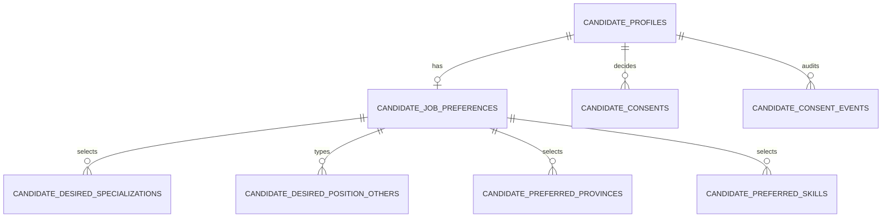

# Đặc tả onboarding ứng viên

Onboarding thu thập nhu cầu tìm việc của ứng viên mới để cá nhân hóa gợi ý việc
làm. Luồng không thay CV, không liên quan onboarding nhà tuyển dụng (luồng xác
thực công ty, domain `employers`) và không dùng query/URL làm căn cứ phân quyền.

Code chính: `backend/apps/candidates` (models `profile.py`, `services/profiles.py`,
`api/serializers/profile.py`); frontend `pages/main/onboarding/OnboardUser.jsx`,
`widgets/onboarding-interview`, `features/configure-job-preferences`,
`entities/candidate-preferences`, `pages/main/account/JobPreferenceSettings.jsx`.

## 1. Luồng người dùng

```text
Đăng nhập (mật khẩu hoặc OAuth)
  └─ job_preferences_configured = false ──> /onboard-user
                                              ├─ trả lời 5 câu ──> lưu ──> /viec-lam?… (lọc sẵn)
                                              └─ "Hoàn thiện sau" ──> /
  └─ job_preferences_configured = true  ──> returnUrl an toàn hoặc trang chủ
```

- Route `/onboard-user` nằm sau `AuthGuard` + `RoleGuard(['candidate'])`,
  dùng `OnboardingLayout`. URL cũ `/onboard-user-setting` chuyển hướng về
  `/onboard-user` để link đã phát ra vẫn chạy.
- Điểm đến sau đăng nhập do `getAuthDestination`
  (`features/auth/model/password-login-destination.js`) quyết định cho **mọi**
  luồng xác thực: đăng nhập mật khẩu, callback OAuth (`OAuthCallback.jsx`) và
  `GuestGuard`. Ứng viên chưa cấu hình luôn được đưa tới `/onboard-user` trước
  khi về `returnUrl`.
- Bỏ qua ("Hoàn thiện sau") không lưu gì và không đổi cờ. Không có
  `OnboardingGuard`: ứng viên chưa cấu hình vẫn dùng site bình thường.
- Khi cờ còn `false`, `JobPreferencesReminder` (trong `MainLayout`) và thông báo
  hệ thống "Cập nhật nhu cầu" trên dải thông báo dẫn về `/onboard-user`. Lời
  nhắc chỉ hiện sau khi email đã xác thực; banner xác thực email luôn ưu tiên.

### Trang onboarding

Toàn bộ onboarding là một cuộc trò chuyện với trợ lý trên một trang
(`OnboardingChat`). Kịch bản ở `widgets/onboarding-interview/model/interview-script.js`:

| Bước | Trường | Ghi chú |
| --- | --- | --- |
| Lĩnh vực | `desired_specialization_ids`, `desired_position_others` | Tối đa 5 vị trí chuyên môn; có thể gõ thêm vị trí tự do. |
| Kinh nghiệm | `experience_level` | Chọn một mốc. |
| Mức lương | `desired_salary_vnd` | VND/tháng; chỉ dùng để lọc, nhà tuyển dụng không thấy. |
| Địa điểm | `preferred_province_ids`, `willing_to_relocate` | Nhiều tỉnh/thành. |
| Cho phép | `ai_recommendation_consent`, `recruiter_visibility_consent` | Hai lựa chọn không tick sẵn. |

- Câu trả lời được gửi một lần ở cuối bằng `PUT /api/candidate/job-preferences/`.
  Lỗi field được hiển thị lại thành tin nhắn và hỏi lại đúng bước đó.
- Lưu thành công: cập nhật `job_preferences_configured` trong session, xóa
  cache gợi ý việc làm, rồi điều hướng tới `/viec-lam` (hoặc
  `/viec-lam/tai/<tỉnh>`) với bộ lọc dựng từ nhu cầu vừa lưu: `cat` = các vị
  trí chuyên môn, `search` = vị trí tự nhập đầu tiên, `locations` = tỉnh đầu
  tiên (`model/personalized-jobs-url.js`).
- Onboarding không hỏi kỹ năng; kỹ năng ưu tiên chỉ chỉnh ở trang cài đặt.

### Trang cài đặt

`/tai-khoan/cai-dat-goi-y-viec-lam` (menu "Cài đặt gợi ý việc làm") dùng chung
`JobPreferencesForm` và cùng endpoint, thêm kỹ năng ưu tiên. Giới tính thuộc
`CandidateProfile` nên được lưu qua endpoint profile riêng
(`/api/candidate/profile/`), không nhét vào preference.

## 2. Mô hình dữ liệu



| Bảng | Nội dung |
| --- | --- |
| `candidate_profiles.job_preferences_configured` | Boolean, mặc định `false`; `true` sau lần lưu preference hợp lệ đầu tiên. Không có trạng thái/bước/timestamp onboarding riêng. |
| `candidate_job_preferences` | 1–1 với profile: `desired_salary_vnd`, `experience_level`, `willing_to_relocate` (null = chưa trả lời), `desired_position_other` (scalar legacy). |
| `candidate_desired_specializations` | FK `job_categories` (PROTECT), `sort_order`; unique theo (preference, category). |
| `candidate_desired_position_others` | Vị trí tự nhập (`name` ≤ 255), `sort_order`; nguồn chuẩn cho `desired_position_others`. Không tạo `JobCategory`. |
| `candidate_preferred_provinces` | FK `locations` (PROTECT), `sort_order`; unique theo (preference, location). |
| `candidate_preferred_skills` | FK `skills` (PROTECT), `sort_order`; unique theo (preference, skill). |
| `candidate_consents` | Quyết định hiện hành theo `consent_type` (`ai_recommendation`, `recruiter_visibility`): `decision` (`granted`/`denied`), `policy_version`, `decided_at`; unique theo (profile, consent_type). |
| `candidate_consent_events` | Lịch sử bất biến mỗi lần quyết định: `source`, `source_path`, `cv_public_id`, `policy_version`. |

`experience_level` là enum riêng của ứng viên (`no_experience`, `under_1`,
`1`…`5`, `over_5`), không dùng lại enum yêu cầu kinh nghiệm của `Job`.

Các field preference cũ trên `CandidateProfile` (`desired_position`,
`preferred_location`, `preferred_work_type`, …) vẫn tồn tại để tương thích;
không map tự động sang dữ liệu chuẩn hóa.

## 3. API

Thuộc `apps/candidates`, quyền `IsCandidate`.

| Endpoint | Mục đích |
| --- | --- |
| `GET /api/candidate/job-preferences/` | Đọc preference, consent hiện hành và `job_preferences_configured`. |
| `PUT /api/candidate/job-preferences/` | Validate toàn bộ, thay các danh sách, upsert consent, đặt cờ `true`. Dùng chung cho onboarding và cài đặt. |
| `GET/PATCH /api/candidate/recruiter-visibility/` | Bật/tắt riêng quyền hiển thị với nhà tuyển dụng (nguồn `cv_save_success` hoặc `account_settings`); bật phải gửi `confirmed=true`. |

Cờ `job_preferences_configured` cũng có trong payload user của auth để
frontend quyết định điều hướng.

### Quy tắc validate của `PUT`

- `desired_specialization_ids`: tối đa 5, không trùng, chỉ category active
  `category_type=specialization`.
- `desired_position_others`: tối đa 5; trim, bỏ rỗng, dedupe không phân biệt
  hoa thường; mỗi mục ≤ 255 ký tự. Hai giới hạn không cộng gộp, nhưng **ít
  nhất một** trong hai nhóm phải có dữ liệu.
- `desired_position_other` (scalar legacy): khi thiếu danh sách chuẩn, backend
  chuyển scalar thành danh sách một phần tử; khi ghi, phần tử đầu được phản
  chiếu vào scalar.
- `preferred_skill_ids`: tùy chọn, tối đa 20 skill active, dedupe theo id. Có
  field thì thay toàn bộ (kể cả mảng rỗng); thiếu field thì giữ danh sách cũ.
- `desired_salary_vnd`: bắt buộc, số nguyên ≥ 1; từ chối `null`, số âm, `0`.
- `experience_level`: bắt buộc, thuộc enum ứng viên.
- `preferred_province_ids`: bắt buộc, không trùng, chỉ location active
  `level=province`; không giới hạn số tỉnh.
- `ai_recommendation_consent`, `recruiter_visibility_consent`: bắt buộc gửi;
  `false` ghi `denied`, không bao giờ suy diễn `granted`.

### Transaction

`replace_candidate_job_preferences` chạy trong `transaction.atomic()`, khóa
profile và preference (`select_for_update`) trước khi thay bảng liên kết. Mỗi
consent được upsert vào `candidate_consents` và ghi thêm một dòng
`candidate_consent_events` với `source='job_preferences'`. Payload lỗi không để
lại dữ liệu dở dang và không đổi cờ.

Endpoint là full replace nên client (`saveJobPreferences`) luôn gửi đủ hai
consent: form không hiển thị checkbox thì giữ lựa chọn cũ thay vì hạ về
`false`.

## 4. Bất biến cần giữ khi sửa

- Chỉ đặt `job_preferences_configured=true` sau khi lưu trọn vẹn một payload
  hợp lệ; bỏ qua không đổi cờ.
- Consent không bao giờ được tick sẵn hay tự cấp.
- Onboarding và trang cài đặt dùng cùng endpoint và cùng logic lưu; không tạo
  state machine onboarding riêng.
- Lời nhắc cập nhật nhu cầu không che banner xác thực email.

## 5. Việc còn mở

- Consent `recruiter_visibility` chỉ bao quyền "nhà tuyển dụng tìm thấy và xem
  hồ sơ/CV"; tính năng lưu hoặc mời lại ứng viên (talent pool) nếu làm sẽ cần
  consent riêng.
- Các field preference legacy trên `CandidateProfile` chưa được gỡ; cần đo
  consumer trước khi xóa ở một release riêng.
- Nếu cần lưu giới tính và preference cùng thành công/thất bại, phải thêm một
  use case gộp có transaction rõ ràng thay vì để serializer preference nhận
  field profile.
