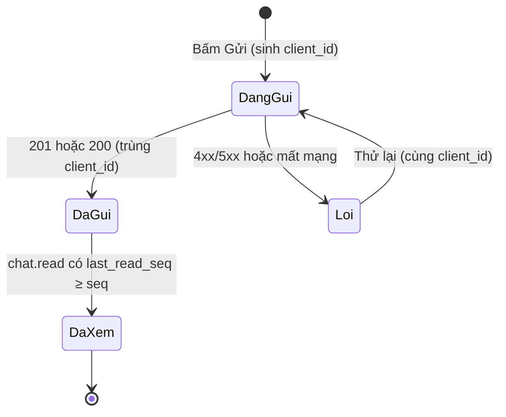
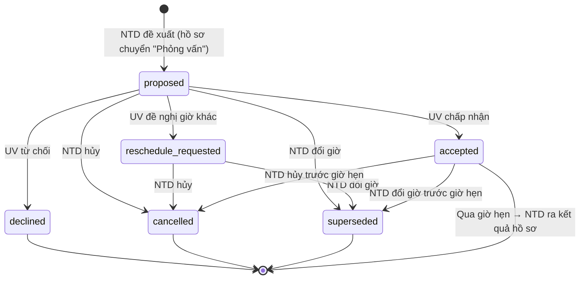
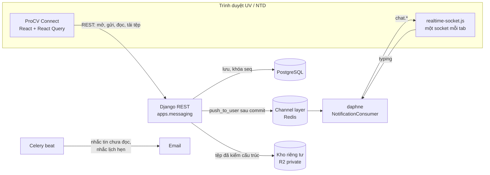

# Đặc tả: ProCV Connect (nhắn tin NTD ↔ ứng viên)

> Quyết định kiến trúc: [ADR-0032](../adr/adr-0032-procv-connect-messaging.md).
> Sơ đồ use case, tuần tự, hoạt động: [`mo-hinh-hoa-yeu-cau/17-procv-connect/`](mo-hinh-hoa-yeu-cau/17-procv-connect/)
> (chức năng 43–47). Hợp đồng API: [`hop-dong-api-procv-connect.md`](../04-api/hop-dong-api-procv-connect.md).
> Cập nhật 26/11/2026.

## 1. Mục tiêu

Nhà tuyển dụng và ứng viên trao đổi trực tiếp, tức thời về một tin tuyển dụng: hỏi đáp,
gửi CV, giới thiệu tin khác, gửi tệp và hẹn lịch phỏng vấn, mà không phải rời ProCV hay
lộ số điện thoại/email trước khi cần.

## 2. Thuật ngữ

| Thuật ngữ | Nghĩa |
| --- | --- |
| Hội thoại | Một cuộc trò chuyện gắn với cặp (tin tuyển dụng, ứng viên) |
| Người phụ trách tin | NTD đang là `job.posted_by`; người duy nhất phía công ty thấy hồ sơ và hội thoại của tin |
| `seq` | Số thứ tự tin trong hội thoại, tăng 1 mỗi tin, dùng để sắp xếp và bù tin hụt |
| `client_id` | UUID trình duyệt sinh cho mỗi lần gửi; gửi lại cùng `client_id` không tạo tin mới |
| Tin hệ thống | Tin do hệ thống ghi (bắt đầu hội thoại, sự kiện lịch hẹn, khóa/mở) |

## 3. Luật nghiệp vụ

### 3.1 Mở hội thoại

| Ai | Điều kiện | Ghi chú |
| --- | --- | --- |
| Ứng viên | Có hồ sơ **hiện hành** vào tin, không ở trạng thái Đã rút | Nút "Nhắn tin" ở cột phải ProCV Connect và ở thẻ Việc làm đã ứng tuyển |
| NTD | Là người phụ trách tin; ứng viên có hồ sơ vào tin **hoặc** đã chấp nhận lời mời kết nối gắn tin đó; qua `ensure_recruiter_candidate_data_access` | Nút ở panel hồ sơ ứng tuyển, Tìm CV, danh sách đã kết nối |
| Cả hai | Công ty không chặn ứng viên; hai tài khoản còn truy cập được; `connect_enabled` bật | Không đạt thì trả câu trung lập, không nói lý do |

Mở lại khi đã có hội thoại trả về hội thoại cũ (một cặp tin–ứng viên chỉ có một hội thoại).

Cổng xác thực + DPA của NTD được kiểm ở **mọi** API phía NTD (danh sách, đọc, gửi, đánh dấu đã đọc,
tệp, lịch hẹn), không chỉ lúc mở hội thoại; NTD mất điều kiện thì cũng không nhận tin qua socket hay
email nhắc cho tới khi đủ điều kiện lại.

### 3.2 Gửi tin

- Thành viên mới gửi được; hội thoại **khóa** thì chỉ đọc.
- Khi NTD chưa trả lời lần nào, ứng viên gửi tối đa `connect_candidate_unanswered_limit`
  tin (mặc định 3). NTD trả lời một lần thì bỏ giới hạn này.
- Throttle: `chat_message_send` 30 tin/phút/người; `chat_conversation_start` 30/giờ;
  cộng trần ghi theo tài khoản (ADR-0031).
- Ứng viên rút hồ sơ → hội thoại chỉ đọc tới khi nộp lại. Tin ngừng tuyển/ẩn vẫn nhắn
  được, thẻ tin ghi "Đã ngừng tuyển".
- Đổi trạng thái hồ sơ **không** sinh tin hệ thống (cửa sổ hoàn tác 15 giây, chuông đã báo).

### 3.3 Khóa và mở

| Sự kiện | Kết quả |
| --- | --- |
| Công ty chặn ứng viên | Khóa mọi hội thoại của ứng viên với công ty; ứng viên thấy "Cuộc trò chuyện hiện không nhận tin nhắn" |
| Gỡ chặn / chặn hết hạn | Mở lại |
| Bàn giao tin cho thành viên khác | Phía NTD là người phụ trách mới ngay (đọc từ `job.posted_by`), lịch sử giữ nguyên |
| Hồ sơ "Không phù hợp" đã báo ứng viên | Đóng gửi tin cả hai bên, vẫn xem lịch sử; không mở hội thoại mới cho hồ sơ đó. Tính theo trạng thái đã báo nên trong 15 giây hoàn tác chưa đóng. Trúng tuyển vẫn nhắn được (trao đổi ngày đi làm, giấy tờ) |
| Ứng viên nộp lại vào tin | Hội thoại mở lại |
| Tài khoản bị khóa | Khóa; mở lại khi tài khoản được mở |
| Xóa tài khoản | Xóa nội dung và tệp của người đó, hiện "Tài khoản đã xóa", khóa vĩnh viễn |

### 3.4 Menu 3 chấm trên dòng hội thoại (chốt 26/11)

- **Xóa cuộc trò chuyện** chỉ phía mình: ẩn hội thoại và mọi tin hiện có khỏi danh sách và luồng
  của người xóa (`*_cleared_seq`); bên kia giữ nguyên. Bên kia nhắn tin mới thì hội thoại hiện lại
  với các tin mới.
- **Chặn tin nhắn** trong hội thoại: không bên nào gửi được (kể cả đặt lịch) tới khi người chặn bỏ
  chặn; bên bị chặn thấy câu trung lập "Cuộc trò chuyện hiện không nhận tin nhắn", không báo là bị
  chặn; "đang soạn tin" cũng dừng. Không ảnh hưởng hồ sơ ứng tuyển và khác với chặn ứng viên theo
  công ty. Người chặn bỏ chặn ở menu hoặc ngay tại khung soạn.

### 3.5 Quyền riêng tư

- Admin không có màn hình đọc hội thoại. Báo cáo tin nhắn vi phạm để giai đoạn sau.
- Email nhắc chỉ ghi số tin mới, người gửi và tin tuyển dụng; không kèm nội dung.
- Tệp và CV chỉ tải qua API kiểm thành viên; không có URL công khai hay presigned.
- Hội thoại nằm trong bản xuất dữ liệu cá nhân của cả hai bên.

## 4. Nội dung gửi được

| `kind` | Ai gửi | Nội dung | Kiểm tra |
| --- | --- | --- | --- |
| `text` | cả hai | Chữ thuần ≤ 2000 ký tự, emoji Unicode, link tự nhận dạng (`rel="noopener nofollow"`) | Không nhận HTML; bỏ ký tự điều khiển |
| `cv` | ứng viên | Một CV đã lưu trong thư viện → bản chụp `CvVersion` | CV thuộc ứng viên; NTD xem qua stream, ghi `CvAccessLog` kênh `message` |
| `job` | NTD (ứng viên chia sẻ lại được tin đang trao đổi) | Thẻ tin: tiêu đề, lương, địa điểm (snapshot) + link trang tin | Tin thuộc công ty, đang công khai |
| `file` / `image` | cả hai | PDF, DOCX, PNG, JPG, WEBP ≤ `connect_attachment_max_mb` (10 MB) | Chữ ký tệp + kiểm cấu trúc như giấy tờ NTD, kho riêng tư |
| `interview` | NTD | Thẻ lịch hẹn (mục 6) | Hồ sơ hiện hành chưa có kết quả, giờ ở tương lai |
| `system` | hệ thống | Bắt đầu hội thoại, sự kiện lịch hẹn, khóa/mở, bàn giao | — |

Kèm theo: "Đang soạn tin…", "Đã xem" ở tin cuối, ngăn ngày Hôm nay/Hôm qua, trạng thái
gửi phía trình duyệt. Bảng emoji tự dựng, tải lười, không gọi CDN. Ngoài phạm vi bản đầu:
sticker mascot ProCV, thu hồi tin, thả cảm xúc lên tin, mẫu trả lời nhanh của NTD, trạng
thái "đang hoạt động".

## 5. Trạng thái tin nhắn (phía trình duyệt)

Tin nhận về được chèn theo `seq`; thấy `seq` lớn hơn seq cuối + 1 thì gọi
`GET …/messages/?after=<seq cuối>` trước khi hiện.

## 6. Lịch hẹn phỏng vấn

Trường: thời điểm bắt đầu, thời lượng (phút), hình thức (trực tiếp / online / điện
thoại), địa điểm hoặc link họp, ghi chú; ứng viên có thể kèm ghi chú khi phản hồi.

**Gắn với trạng thái hồ sơ** (chốt 26/11):
- Gửi lịch là mời phỏng vấn: hồ sơ "Mới / Đã xem / Phù hợp" chuyển "Phỏng vấn" qua đúng
  `change_application_status` (lịch sử, hoạt động chiến dịch) và báo ứng viên **ngay**, một thông
  báo trỏ vào hội thoại (không qua cửa sổ hoàn tác vì lịch đã hiện trong chat). Hồ sơ đã ở
  "Phỏng vấn" (lịch mới, đổi giờ) thì báo riêng về lịch hẹn. Nhờ vậy hồ sơ có lịch không còn bị
  tính "chưa phản hồi" (không bị nhắc/tự từ chối nhầm).
- Ứng viên xin đổi giờ → thẻ phía NTD có "Đổi giờ": form điền sẵn hình thức, địa điểm/link, ghi
  chú và hiện ghi chú của ứng viên; gửi là lịch mới thay lịch cũ.
- Qua giờ hẹn đã nhận: thẻ ghi "Đã diễn ra"; phía NTD có Trúng tuyển / Không phù hợp (quyết định
  hồ sơ bình thường, có cửa sổ hoàn tác). Không còn trạng thái "đã phỏng vấn" riêng của lịch.
- Chờ kết quả: mốc là lúc buổi hẹn kết thúc (`Application.interview_ended_at`), không có lịch thì
  lúc mời phỏng vấn. Quá `interview_decision_reminder_days` (mặc định 3) chưa có kết quả → nhắc NTD
  một lần (chuông + email, không dữ liệu cá nhân) và ứng viên được bấm "Nhắc NTD". **Không tự từ
  chối** hồ sơ đã phỏng vấn.
- Chấp nhận → email kèm tệp `.ics` cho hai bên; beat nhắc trước 24 giờ và 1 giờ.
- Mỗi lần đổi trạng thái lịch: tin hệ thống + thẻ cập nhật (`chat.message.updated`) + chuông.

## 7. Kiến trúc

Chi tiết từng luồng ở sơ đồ tuần tự 43–47.

## 8. Dữ liệu

| Bảng | Trường chính | Ràng buộc |
| --- | --- | --- |
| `Conversation` (`cnv`) | `job`, `candidate`, `company`, `origin` (application/invitation), `last_seq`, `last_message_at`, `last_message_preview`, `last_message_kind`, `last_sender_role`, `candidate_/recruiter_last_read_seq`, `candidate_/recruiter_unread`, `candidate_/recruiter_emailed_seq`, `recruiter_replied_at` | Duy nhất `(job, candidate)`; phía NTD = `job.posted_by` |
| `Message` (`msg`) | `conversation`, `seq`, `sender` (null = hệ thống), `sender_role`, `kind`, `body`, `payload` (snapshot thẻ, sự kiện hệ thống), `shared_job`, `cv_version`, `interview`, `attachment_*`, `client_id`, `created_at`, `erased_at` | Duy nhất `(conversation, seq)` và `(sender, client_id)` |
| `InterviewAppointment` (`itv`) | `conversation`, `application`, `proposed_by`, `starts_at`, `duration_minutes`, `mode`, `location`, `meeting_url`, `note`, `status`, `candidate_note`, `responded_at`, `reminded_24h_at`, `reminded_1h_at` | Tối đa một lịch `proposed` mỗi hồ sơ |

## 9. API

Theo cổng, không có `/v2/`. `{id}` là `public_id`.

| Phương thức | Đường dẫn | Mục đích |
| --- | --- | --- |
| GET | `/api/{candidate,employer}/conversations/?q=` | Danh sách hội thoại, mới nhất trước |
| POST | `/api/candidate/conversations/` `{job}` | Ứng viên mở hội thoại |
| POST | `/api/employer/conversations/` `{application}` hoặc `{invitation}` | NTD mở hội thoại |
| GET | `/api/{portal}/conversations/{id}/` | Ngữ cảnh: tin, công ty/ứng viên, trạng thái hồ sơ đã công bố |
| GET | `/api/{portal}/conversations/{id}/messages/?before=&after=&limit=30` | Lịch sử theo seq |
| POST | `/api/{portal}/conversations/{id}/messages/` | Gửi tin (`client_id`, `kind`, nội dung theo kind) |
| POST | `/api/{portal}/conversations/{id}/read/` `{seq}` | Đánh dấu đã đọc |
| GET | `/api/{portal}/conversations/unread-count/` | Badge chưa đọc |
| GET | `/api/{portal}/conversations/{id}/messages/{msg}/file/` | Tải tệp/CV |
| GET | `/api/candidate/conversations/applied-jobs/` | Cột phải "Tin tuyển dụng đã ứng tuyển" |
| GET | `/api/employer/conversations/shareable-jobs/` | Tin có thể gửi |
| POST | `/api/employer/conversations/{id}/interviews/` | Đề xuất lịch hẹn |
| POST | `/api/candidate/interviews/{id}/respond/` | Chấp nhận / từ chối / đề nghị giờ khác |
| POST | `/api/employer/interviews/{id}/cancel/` | Hủy lịch hẹn |

## 10. Giao diện

- **Ứng viên** `/procv-connect` (và `/procv-connect/:id`): layout riêng gọn, logo "ProCV
  Connect" + "Về trang chủ". Ba cột: danh sách hội thoại có ô tìm, khung chat, "Tin tuyển
  dụng đã ứng tuyển" với nút Nhắn tin.
- **NTD** `/tuyendung/app/procv-connect` trong workspace: danh sách hội thoại, khung chat, cột
  phải tóm tắt hồ sơ ứng tuyển và nút Đặt lịch phỏng vấn.
- **Responsive:** desktop 3 cột; tablet 2 cột, cột phải thành ngăn kéo; mobile danh sách
  ↔ khung chat theo route, ngữ cảnh tin trong bottom sheet.
- Khung soạn: Enter gửi, Shift+Enter xuống dòng; nút emoji; nút đính kèm (Gửi CV / Gửi tin
  tuyển dụng / Gửi tệp / Đặt lịch phỏng vấn tùy vai).
- Badge chưa đọc ở icon tin nhắn header ứng viên và mục menu NTD; toast + âm báo dùng
  chung cơ chế chuông (một tab kêu).

## 11. Giai đoạn

| GĐ | Nội dung |
| --- | --- |
| 0 | ADR-0032, đặc tả này, sơ đồ 43–47 |
| 1 | Backend lõi: app `messaging`, mở/gửi chữ/đọc/badge, `typing` trong consumer, sự kiện, signal chặn/bàn giao/xóa tài khoản, cấu hình, throttle, OpenAPI, test |
| 2 | Frontend lõi: route, inbox 3 cột responsive, emoji, realtime + bù seq, badge, nút vào chat, i18n, e2e |
| 3 | Gửi CV, thẻ tin, tệp/ảnh |
| 4 | Lịch hẹn phỏng vấn, nhắc, email `.ics` |
| 5 | Email nhắc tin chưa đọc, xuất dữ liệu cá nhân, xóa nội dung khi xóa tài khoản |

## 12. Kiểm thử

- Service: điều kiện mở hội thoại (hồ sơ, lời mời, chặn, rút), giới hạn 3 tin, idempotent
  `client_id`, cấp seq khi gửi đồng thời, khóa/mở theo signal.
- API: quyền hai cổng (NTD khác tin, ứng viên khác không đọc được), phân trang
  before/after, ngân sách truy vấn danh sách hội thoại.
- Realtime: đẩy sau commit (rollback không đẩy), `typing` của người ngoài hội thoại bị bỏ,
  `typing` dồn dập bị bỏ.
- E2E: hai cổng gửi–nhận, mobile Pixel 5, 834×1112, desktop không tràn ngang.
