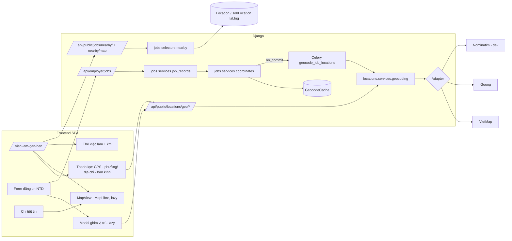
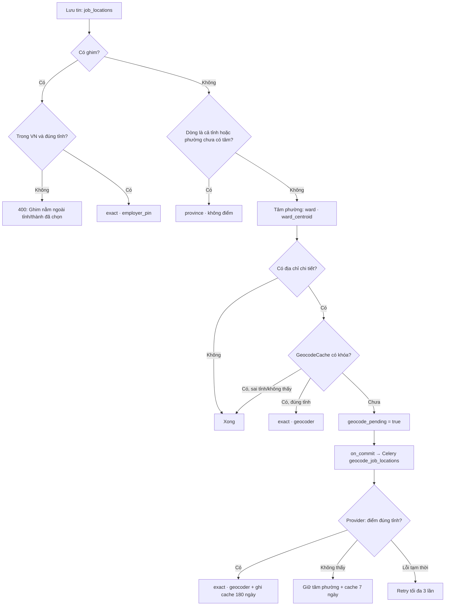
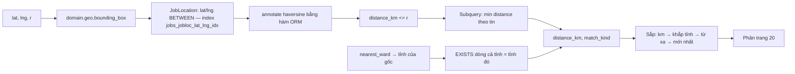

# Đặc tả: Việc làm gần tôi (tìm việc theo khoảng cách)

> Quyết định kiến trúc: [ADR-0029](../adr/adr-0029-nearby-jobs-geo.md).
> Trang ứng viên: `/viec-lam-gan-ban`. Cập nhật 25/11/2026.

## 1. Mục tiêu

Ứng viên xem việc làm quanh một vị trí trên **bản đồ + danh sách**, chọn **bán kính**
(3/5/10/20/50 km, trần do admin cấu hình) và lấy vị trí theo một trong bốn cách: vị trí
hiện tại của thiết bị, chọn phường/xã, nhập địa chỉ, bấm/kéo ghim trên bản đồ. Kết hợp
được với bộ lọc ngành nghề, mức lương và việc làm từ xa.

## 2. Các trường hợp nhập địa điểm của NTD và cách xử lý

Form đăng tin: mỗi **vùng** = một tỉnh; trong vùng có nhiều **nơi làm việc** = phường/xã
(hoặc "Tất cả" = cả tỉnh) + địa chỉ chi tiết + **ghim tùy chọn**. Payload dẹt thành
`job_locations[]`. Hình thức remote nằm ở trường riêng `work_types`.

| # | NTD nhập | Tọa độ được gán | Độ chính xác | Khi ứng viên tìm gần |
|---|---|---|---|---|
| 1 | Phường + địa chỉ, có ghim | Ghim (server kiểm trong VN, đúng tỉnh) | `exact` | Tính km thật |
| 2 | Phường + địa chỉ, không ghim | Geocode "địa chỉ, phường, tỉnh"; trong lúc chờ: tâm phường | `exact` / `ward` | Tính km |
| 3 | Phường, không địa chỉ | Tâm phường | `ward` | Tính km (ước tính) |
| 4 | Một tỉnh, nhiều phường/địa chỉ | Mỗi dòng một điểm | theo dòng | km của tin = nơi gần nhất; thẻ ghi "+N nơi làm việc gần"; bản đồ vẽ mọi nơi trong bán kính |
| 5 | Cùng phường, nhiều địa chỉ | Geocode từng địa chỉ | theo dòng | Điểm trùng gom thành một ghim có số đếm |
| 6 | "Tất cả" (cả tỉnh) | Không có điểm | `province` | Nhóm **"Tuyển khắp tỉnh X"** khi vị trí ứng viên thuộc tỉnh X, xếp sau tin có km; không vẽ ghim |
| 7 | Nhiều tỉnh (trộn các kiểu trên) | Theo từng dòng | theo dòng | Tin hiện nếu bất kỳ dòng nào khớp; khớp km ưu tiên hơn khớp cả tỉnh |
| 8 | Tin cũ / nhập hàng loạt (dòng cấp tỉnh) | Không có điểm | `province` | Như #6 |
| 9 | Geocoder trả điểm ở tỉnh khác | Bỏ kết quả, giữ tâm phường | `ward` | Như #3 |
| 10 | Ghim ngoài VN / khác tỉnh / thiếu một trục | Server trả 400 | — | — |
| 11 | Sửa địa chỉ hoặc đổi phường sau khi ghim | Form tự bỏ ghim → geocode lại | — | — |
| 12 | Chỉ làm từ xa (`work_types == ['remote']`) | — | — | Mặc định ẩn; bật "Gồm việc làm từ xa" thì hiện nhóm "Làm việc từ xa" (có văn phòng gần thì vẫn tính km) |
| 13 | Hybrid/onsite | — | — | Như thường |
| 14 | Tin đóng / hết hạn / bị giữ | — | — | Loại bởi `publicly_available_job_filter` |
| 15 | "Toàn quốc" | Không tồn tại trong hệ thống | — | Ngoài phạm vi |

"Đúng tỉnh" được kiểm cục bộ: phường có tâm gần điểm nhất (`nearest_ward`) phải thuộc
tỉnh của dòng. Không gọi nhà cung cấp.

## 3. Sơ đồ luồng

### 3.1 Kiến trúc



### 3.2 Gán tọa độ khi NTD lưu/đăng tin



### 3.3 Ứng viên tìm việc gần

```mermaid
flowchart TD
  S[Mở /viec-lam-gan-ban] --> R{URL có ?gan=slug-phường hoặc phiên đã có vị trí?}
  R -- Có --> Q
  R -- Không --> CH[Thẻ hướng dẫn chọn vị trí]
  CH -->|Dùng vị trí của tôi| G1{HTTPS + trình duyệt hỗ trợ?}
  G1 -- Không --> E1[Thông báo + gợi ý chọn phường/xã]
  G1 -- Có --> G2{Quyền vị trí}
  G2 -- Từ chối --> E2[Hướng dẫn bật quyền ở biểu tượng ổ khoá]
  G2 -- Hết giờ/không lấy được --> E3[Thử lại / chọn phường]
  G2 -- OK --> G3{Trong VN?}
  G3 -- Không --> E4[Chỉ hỗ trợ trong VN]
  G3 -- Có --> ACC[Sai số > 1 km → ghi chú]
  CH -->|Gõ tên| AC[Gợi ý: phường/xã cục bộ trước, địa chỉ VietMap sau]
  AC -->|phường| Q
  AC -->|địa chỉ| PL[/geo/place → tọa độ/] --> Q
  CH -->|Bấm/kéo ghim trên bản đồ| Q
  ACC --> Q[Gốc lat,lng làm tròn 3 số + bán kính + bộ lọc]
  Q --> API[GET /jobs/nearby/ + /jobs/nearby/map/]
  API --> RS{Có kết quả?}
  RS -- Có --> V[Danh sách theo km · nhóm khắp tỉnh · ghim bản đồ]
  RS -- Không --> EX[Nút "Mở rộng 20 km (N việc)"]
  V -->|Bấm ghim| HL[Tô sáng + cuộn tới thẻ tương ứng]
```

### 3.4 Truy vấn khoảng cách (không PostGIS)



## 4. API

| Endpoint | Tham số | Trả về |
|---|---|---|
| `GET /api/public/jobs/nearby/` | `lat`, `lng` (bắt buộc), `radius_km`, `include_province_wide` (mặc định 1), `include_remote` (0), `ordering=distance\|newest\|salary_desc` + mọi bộ lọc của `/public/jobs/` | Trang thẻ tin + `distance_km`, `match_kind`, `nearest_workplace`, `nearby_workplace_count`, `deadline`; thêm `origin` (phường/tỉnh gần nhất) và `expand_suggestion` khi rỗng |
| `GET /api/public/jobs/nearby/map/` | như trên (không phân trang) | `points[]` gom theo tọa độ: `latitude`, `longitude`, `precision`, `label` (tên phường), `jobs[]`; `truncated` khi vượt `nearby_jobs_max_markers` |
| `GET /api/public/locations/geo/autocomplete/?q=` | `q` ≥ 2 ký tự, `lat`/`lng` để ưu tiên gần | Phường/xã cục bộ (`type=ward`, có tọa độ) rồi địa chỉ của nhà cung cấp (`type=place`, `ref`) |
| `GET /api/public/locations/geo/place/?ref=` | `ref` từ gợi ý | `latitude`, `longitude`, `label`; 404 nếu không xác định được |
| `GET /api/public/locations/geo/wards/<slug>/` | — | Tâm và tỉnh của phường (gốc chia sẻ qua URL `?gan=`) |

Throttle ẩn danh: `nearby_jobs` 120/phút, `geo_lookup` 60/phút. Lỗi: tọa độ thiếu/sai
hoặc ngoài VN → 400; tính năng tắt (`nearby_jobs_enabled`) → 404.

## 5. Giao diện

- Bố cục theo mẫu: breadcrumb → tiêu đề "Việc làm gần tôi tại <tỉnh>" → khung lọc
  (nút **Dùng vị trí của tôi** · "hoặc" · ô chọn phường/xã/địa chỉ; hàng 2: chip bán
  kính, ngành nghề, mức lương, "Gồm việc làm từ xa", **Tìm việc**) → bản đồ trái / danh
  sách phải (≥ 1024 px), xếp chồng trên mobile.
- Bản đồ: vòng bán kính nét đứt, ghim xanh là gốc (kéo được), ghim cam là nơi làm việc
  kèm tên phường rút gọn ("P. Điện Bàn"), số đếm khi nhiều tin cùng điểm. Chú thích dưới
  bản đồ: tin không có tọa độ không hiện trên bản đồ.
- Thẻ tin: logo, tiêu đề + nhãn "Gấp", công ty, lương, phường/tỉnh, hạn nộp, chip
  khoảng cách ("850 m", "3,4 km", "Khắp tỉnh", "Từ xa").
- Lối vào: menu Việc làm ở header, chip "Tìm việc gần tôi" ở trang chủ.
- Chi tiết tin: bản đồ nhỏ các nơi làm việc và "Cách bạn x km" nếu phiên đã có vị trí.
- Form NTD: nút "Ghim trên bản đồ" ở mỗi phường/xã; modal đặt ghim gợi ý từ địa chỉ
  (hoặc tâm phường), cảnh báo khi ghim cách tâm phường > 15 km.

## 6. Cấu hình

- Site settings: `nearby_jobs_enabled`, `nearby_jobs_default_radius_km` (10),
  `nearby_jobs_max_radius_km` (50), `nearby_jobs_max_markers` (300), `map_style_url`,
  `map_attribution` — xem [cau-hinh-site-settings.md](../05-huong-dan/cau-hinh-site-settings.md).
- Env backend: `GEOCODING_PROVIDER`, `GEOCODING_API_KEY`, `GEOCODING_TIMEOUT_SECONDS`,
  `GEOCODING_USER_AGENT`.
- Lệnh: `seed_location_coordinates` (sau `seed_locations`), `refresh_job_coordinates`
  (backfill tin cũ, `--all` tính lại trừ ghim NTD), `build_location_centroids <thư mục GeoJSON>`
  (chỉ khi ranh giới đổi).

## 7. Kiểm thử

- Backend: `apps/locations/tests/test_geo.py` (hình học, selector, adapter, seed),
  `apps/jobs/tests/test_workplace_coordinates.py` (các trường hợp #1–#11),
  `apps/jobs/tests/test_nearby_jobs.py` (sắp xếp, bán kính, khắp tỉnh, từ xa, bộ lọc,
  bản đồ, tra địa chỉ, header, số query phẳng), `test_seo.py`.
- Frontend: `shared/lib/geo.test.js`, `pages/main/jobs/lib/nearby-params.test.js`,
  `model/use-current-position.test.js`, `NearbyJobs.test.jsx`, `job-form-values.test.js`,
  `header-navigation-config.test.jsx`; E2E `tests/e2e/smoke/nearby-jobs.spec.js` (`@responsive`).
