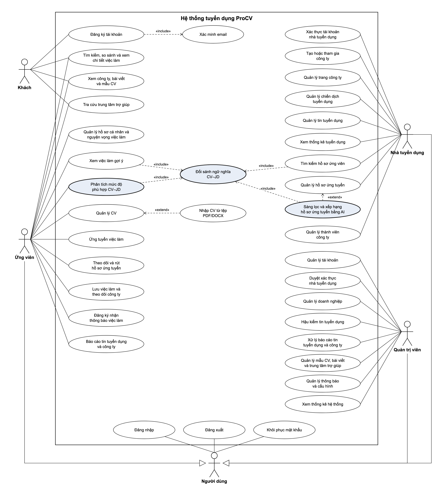

# 01 - Phân tích

Phạm vi:
- Bối cảnh và vấn đề cần giải quyết (ứng viên, nhà tuyển dụng)
- Mục tiêu, phạm vi MVP, đối tượng sử dụng
- Vai trò người dùng và quyền hạn
- Danh sách chức năng chi tiết (F01-F20)

Nguồn: PRD_AI_Career_Coach v1.1.

## Sơ đồ use case tổng quát (cập nhật 2026-11-16)

Bản chỉnh sửa được: [`so-do-use-case.drawio`](so-do-use-case.drawio) (mở bằng
diagrams.net), bản vector: [`so-do-use-case.svg`](so-do-use-case.svg). Ô nền
xanh viền đậm là chức năng AI chạy local do hệ thống tự xây dựng. Sơ đồ chỉ giữ
use case ở mức nghiệp vụ; thao tác nhỏ nằm trong use case chứa nó (cột "Gồm").

### Tác nhân

| Tác nhân | Mô tả |
| --- | --- |
| Khách | Người chưa đăng nhập |
| Người dùng | Tác nhân trừu tượng, cha của Ứng viên, Nhà tuyển dụng, Quản trị viên |
| Ứng viên | Tài khoản cổng ứng viên |
| Nhà tuyển dụng | Tài khoản cổng nhà tuyển dụng; người giữ vai trò quản lý công ty có thêm quyền quản lý thành viên |
| Quản trị viên | Admin thường và superuser (ADR-0018) |

### Danh sách use case

✅ đã có trong code, ⬜ sẽ làm.

| Tác nhân | Use case | Gồm | Trạng thái |
| --- | --- | --- | --- |
| Khách | Đăng ký tài khoản («include» Xác minh email) | Cổng ứng viên và cổng NTD | ✅ |
| Khách, Ứng viên | Tìm kiếm, so sánh và xem chi tiết việc làm | Lọc, so sánh việc làm | ✅ |
| Khách, Ứng viên | Xem công ty, bài viết và mẫu CV | | ✅ |
| Khách, Ứng viên | Tra cứu trung tâm trợ giúp | | ✅ |
| Ứng viên | Quản lý hồ sơ cá nhân và nguyện vọng việc làm | Cho phép NTD tìm thấy hồ sơ | ✅ |
| Ứng viên | Xem việc làm gợi ý («include» Đối sánh ngữ nghĩa CV–JD) | | ✅ theo luật, ⬜ chuyển sang đối sánh ngữ nghĩa |
| Ứng viên | Phân tích mức độ phù hợp CV–JD («include» Đối sánh ngữ nghĩa CV–JD) | | ⬜ |
| Ứng viên | Quản lý CV; Nhập CV từ tệp PDF/DOCX («extend») | Chia sẻ và tải CV | ✅ |
| Ứng viên | Ứng tuyển việc làm | Nộp lại sau khi bị từ chối hoặc đã rút | ✅ |
| Ứng viên | Theo dõi và rút hồ sơ ứng tuyển | Trạng thái đã công bố, rút hồ sơ, nhắc NTD | ✅ |
| Ứng viên | Lưu việc làm và theo dõi công ty | | ✅ |
| Ứng viên | Đăng ký nhận thông báo việc làm | | ✅ |
| Ứng viên | Báo cáo tin tuyển dụng và công ty | | ✅ |
| Nhà tuyển dụng | Xác thực tài khoản nhà tuyển dụng | Giấy phép kinh doanh, số điện thoại, cam kết bảo vệ dữ liệu | ✅ |
| Nhà tuyển dụng | Tạo hoặc tham gia công ty | Gửi yêu cầu tham gia, chờ quản lý công ty duyệt | ✅ |
| Nhà tuyển dụng | Quản lý trang công ty | Khi có quyền biên tập | ✅ |
| Nhà tuyển dụng | Quản lý chiến dịch tuyển dụng; Quản lý tin tuyển dụng | Gia hạn, mở lại, sửa và gửi lại khi bị yêu cầu sửa | ✅ |
| Nhà tuyển dụng | Xem thống kê tuyển dụng | | ✅ |
| Nhà tuyển dụng | Tìm kiếm hồ sơ ứng viên («include» Đối sánh ngữ nghĩa CV–JD) | | ⬜ |
| Nhà tuyển dụng | Quản lý hồ sơ ứng tuyển | Đổi trạng thái, chặn ứng viên theo công ty | ✅ |
| Nhà tuyển dụng | Sàng lọc và xếp hạng hồ sơ ứng tuyển bằng AI («extend» Quản lý hồ sơ ứng tuyển, «include» Đối sánh ngữ nghĩa CV–JD) | | ⬜ |
| Nhà tuyển dụng | Quản lý thành viên công ty (chỉ quản lý công ty) | Duyệt yêu cầu tham gia, cấp/thu quyền biên tập, chuyển quyền quản lý, gỡ thành viên, giao tin và chiến dịch | ✅ |
| Quản trị viên | Quản lý tài khoản | | ✅ |
| Quản trị viên | Duyệt xác thực nhà tuyển dụng | | ✅ |
| Quản trị viên | Quản lý doanh nghiệp | Duyệt yêu cầu cập nhật thông tin; duyệt tham gia và chỉ định quản lý khi công ty chưa có quản lý đủ điều kiện | ✅ |
| Quản trị viên | Hậu kiểm tin tuyển dụng | Tạm giữ, yêu cầu sửa, khóa, duyệt bản gửi lại | ✅ |
| Quản trị viên | Xử lý báo cáo tin tuyển dụng và công ty | | ✅ |
| Quản trị viên | Quản lý mẫu CV, bài viết và trung tâm trợ giúp | | ✅ |
| Quản trị viên | Quản lý thông báo và cấu hình; Xem thống kê hệ thống | | ✅ |
| Người dùng | Đăng nhập; Đăng xuất; Khôi phục mật khẩu | | ✅ |
| (dùng chung) | Đối sánh ngữ nghĩa CV–JD | | ⬜ |

### Thay đổi so với bản 2026-11-15

Theo các đợt thống nhất luồng (#208–#215, #222–#227):

- Thêm Quản lý thành viên công ty cho Nhà tuyển dụng (chỉ người giữ vai trò
  quản lý công ty). Duyệt tham gia do quản lý công ty làm, tách khỏi xác thực
  tài khoản do quản trị viên làm. Không tách tác nhân riêng để sơ đồ gọn.
- "Quản lý thông tin và xác thực doanh nghiệp" tách thành Xác thực tài khoản nhà
  tuyển dụng và Tạo hoặc tham gia công ty.
- "Duyệt xác thực và cập nhật doanh nghiệp" tách thành Duyệt xác thực nhà tuyển
  dụng và Quản lý doanh nghiệp (thêm duyệt tham gia thay, chỉ định quản lý).
- Thêm Hậu kiểm tin tuyển dụng cho quản trị viên (vòng yêu cầu sửa).
- "Theo dõi hồ sơ ứng tuyển" đổi thành Theo dõi và rút hồ sơ ứng tuyển.
- Gộp use case nhỏ: So sánh việc làm vào Tìm kiếm; Chia sẻ và tải CV vào Quản
  lý CV; Lưu việc làm với Theo dõi công ty; Quản lý mẫu CV, bài viết và trung
  tâm trợ giúp thành một use case.

### Phạm vi AI đã chốt

Mở rộng ngày 2026-11-15: thêm fine-tune mô hình, baseline cho thực nghiệm, kỹ
năng khớp/thiếu và gợi ý cải thiện CV. Tên các use case không đổi nên sơ đồ giữ
nguyên. Lộ trình ở [tiến độ dự án](../TIEN-DO-DU-AN.md#đối-sánh-ngữ-nghĩa-cvjd-chạy-local-2026-11-15).

- Đối sánh ngữ nghĩa CV–JD chạy và huấn luyện local: bi-encoder đa ngôn ngữ mã
  nguồn mở (`intfloat/multilingual-e5-base`) fine-tune trên máy, pipeline tự xây
  (trích kỹ năng, chấm điểm nhiều tiêu chí, vector lưu bằng pgvector), không gọi
  API ngoài. TF-IDF và BM25 chỉ làm baseline trong thực nghiệm.
- Ứng viên: Phân tích mức độ phù hợp CV–JD trả điểm tổng và điểm theo tiêu chí
  (kỹ năng, kinh nghiệm, học vấn, cấp bậc, địa điểm), kỹ năng khớp và kỹ năng
  còn thiếu, giải thích kèm bằng chứng trong CV, và gợi ý cải thiện CV sinh bằng
  luật (không dùng LLM). Xử lý được tin tiếng Việt và tiếng Anh. Việc làm gợi ý
  dùng chung module này.
- Nhà tuyển dụng: Sàng lọc và xếp hạng hồ sơ ứng tuyển theo điểm. Tìm kiếm hồ sơ
  ứng viên chọn một tin của NTD rồi xếp ứng viên theo độ phù hợp, chỉ gồm ứng
  viên đã cho phép NTD tìm thấy hồ sơ.
- Nhập CV từ tệp, AI tạo tin tuyển dụng (thuộc Quản lý tin tuyển dụng) và AI
  sinh nội dung CV mẫu vẫn gọi dịch vụ AI bên ngoài; sơ đồ vẽ như use case
  thường.
