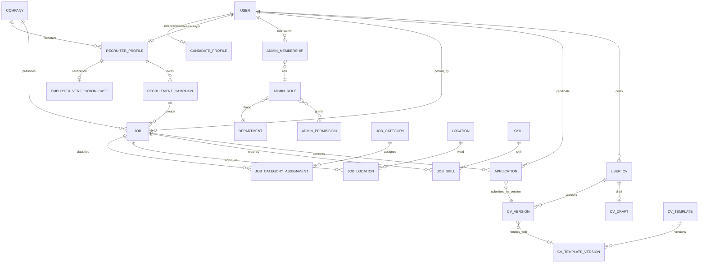
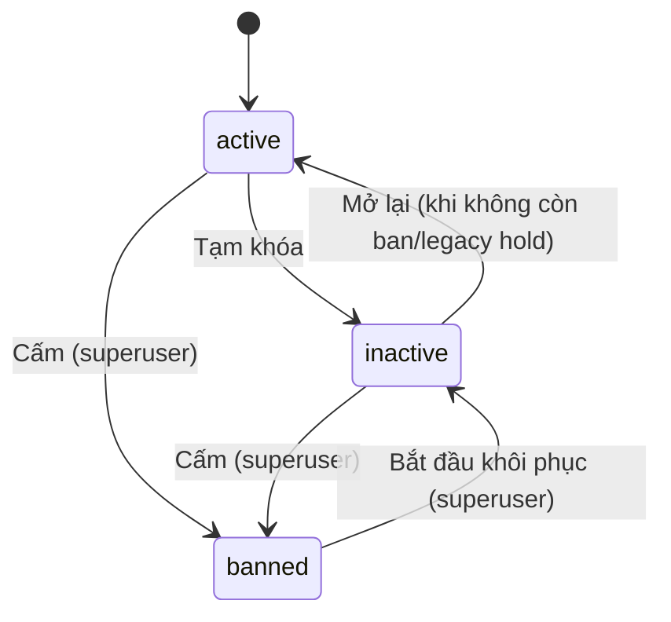

# 03 - Thiết kế database

Tài liệu mô tả schema **hiện hành** của backend (PostgreSQL, Django ORM). Nguồn
sự thật là model trong `backend/apps/<app>/models/`; khi tài liệu và model lệch
nhau, model đúng. Tài liệu chỉ liệt kê bảng, mục đích, field then chốt, quan hệ
và ràng buộc — không liệt kê đủ mọi cột.

Tài liệu liên quan:

- Quy tắc nghiệp vụ tin/chiến dịch: [đặc tả chiến dịch và tin tuyển dụng](../01-phan-tich/dac-ta-chien-dich-va-tin-tuyen-dung.md),
  [ADR-0014](../02-tong-quan/adr-0014-job-post-moderation.md),
  [ADR-0015](../02-tong-quan/adr-0015-remove-commercial-services.md).
- Nhà tuyển dụng/công ty: [đặc tả nhà tuyển dụng](../01-phan-tich/dac-ta-nha-tuyen-dung.md),
  [decision log](../02-tong-quan/employer-remediation-decision-log.md).
- CV Builder: [kiến trúc CV Builder](../02-tong-quan/cv-builder-architecture-foundation.md).
- Media/storage key và API: [tài liệu API](../04-api/tai-lieu-api.md).

## 1. Quy ước chung

| Quy ước | Nội dung |
| --- | --- |
| Tên bảng | Mặc định của Django `<app>_<model>` (vd `accounts_user`, `jobs_job`, `employers_company`, `cvs_usercv`). Ngoại lệ đặt `db_table` tường minh: `candidate_*` (preference/consent/email settings), `candidate_hidden_jobs`, `upload_sessions`, `upload_assets`, `upload_scan_attempts`, `ai_invocations`, `ai_usage_daily`. |
| Khóa | `id` BigAutoField chỉ dùng nội bộ. `AuthSession.id` là UUID (nhúng vào claim `sid`). |
| `public_id` | Định danh lộ ra URL/API, sinh bởi `common.public_id.generate_public_id(prefix)` dạng `<prefix>_<12 hex>` (vd `usr_`, `co_`, `jb_`, `app_`, `cvv_`). API không bao giờ nhận/trả `id` số. |
| `slug` | Unique, tự sinh khi trống. `Job.slug = slugify(title)-<public_id>` để không trùng; slug blog sinh bởi `friendly_post_slug` (ngắn, không gắn `public_id`) và admin được sửa tay; slug bài knowledgebase unique theo `(category, slug)`. |
| Soft delete | Chỉ `User` và `UserCv` có `is_deleted` + `deleted_at`. Các aggregate nội dung dùng trạng thái `archived` thay cho xóa mềm. Bảng bằng chứng (event/history/report) chặn xóa. |
| JSONB | Chỉ cho dữ liệu không cần ràng buộc quan hệ hoặc lọc: document CV (`content_json`/`layout_json`/`style_json`), snapshot/payload audit, `SiteSetting.value`, cấu hình template, danh sách nhỏ có thứ tự (`Job.application_reasons`, `Job.work_types`, `Company.markets`). Taxonomy, kỹ năng, địa điểm, quyền lợi luôn là bảng quan hệ, không lưu JSON hay chuỗi phân cách. |
| Status | `CharField` + `TextChoices`, giá trị lưu tiếng Anh ổn định, nhãn tiếng Việt. Các status quan trọng có `CheckConstraint` (`chk_users_status`, `chk_jobs_status`, `chk_applications_status`, `chk_user_cvs_status`, `chk_blog_post_status`…). |
| Tên constraint | `uq_*`/`uniq_*` cho unique, `chk_*` cho check. Unique theo điều kiện dùng partial `UniqueConstraint(condition=...)` (một bản ghi "đang hiệu lực"/"mặc định"/"đang mở"). |
| Media | Cột ảnh/file (`avatar_url`, `Company.logo_url`/`cover_image_url`, `CompanyImage.image_url`, `CompanyDocument.file_url`, `JobCategory.logo_url`, `Banner.image_url`, `Post.thumbnail_url`, `UserCv.*_url`) lưu **storage key**, API resolve thành URL public theo domain/CDN hiện tại. Ảnh chèn trong HTML bài blog lưu URL cuối cùng. |
| Bảng append-only | Event/history/evidence không được sửa: `save()` chặn update khi đã có `pk` và/hoặc `delete()` raise (vd `AccountStatusTransition`, `JobModerationEvent`, `JobReport`, `CvVersion`, `*Event` của employers). Mọi ghi audit đi cùng transaction với thay đổi nghiệp vụ. |
| Khóa đồng thời | Aggregate sửa đồng thời có `lock_version`/`revision_token`/`edit_revision` (optimistic CAS, trả `409` khi lệch). Workflow quản trị nguy hiểm dùng impact token + `select_for_update`. |

## 2. Sơ đồ quan hệ lõi

## 3. Tài khoản, phiên và RBAC admin (`accounts`)

| Bảng (model) | Mục đích, field then chốt và ràng buộc |
| --- | --- |
| `User` | Custom user (`AbstractUser`, không có `username`/`first_name`/`last_name`), đăng nhập bằng `email`. `role` ∈ candidate/employer/admin, `status` ∈ active/inactive/banned/pending, `provider` (local/google/facebook/linkedin/github), `email_verified`, cờ 2FA (email/TOTP/backup code hash), `auth_revision` (tăng đơn điệu để vô hiệu mọi phiên/artifact cũ). Email **không** unique toàn cục: `uniq_users_email_role_lower` unique `(Lower(email), role)` — mỗi cổng một tài khoản độc lập, cùng email được dùng ở cổng khác. |
| `SocialAccount` | Liên kết OAuth; `raw_profile` JSON; unique `(provider, provider_user_id, user)`. |
| `AuthSession` | Một phiên/thiết bị: `portal`, `refresh_jti` (unique, chỉ lưu jti), `auth_revision`, `expires_at`, `revoked_at`. Access token bắt buộc có `sid` trỏ tới phiên còn hiệu lực. |
| `AuthEmailJob` | Outbox email bảo mật (verification, welcome, reset mật khẩu, 2FA, mời admin, thông báo đổi email/MFA/trạng thái); `status` pending→sending→sent/failed/cancelled; tối đa một email welcome mỗi user. |
| `AccountStatusTransition` | Bằng chứng bất biến cho mỗi quyết định trạng thái tài khoản (mục 3.2). |
| `AdminPermission` | Mirror registry code-owned `accounts/constants/admin_permissions.py`; `code` unique, `module`, `is_active` (code bị bỏ được deprecate, không xóa). |
| `Department`, `AdminRole` | Phòng ban và chức danh; role unique `(department, code)`, M2M permission, `rank` chỉ để hiển thị/chọn primary, `is_system_managed` phân biệt bản ghi seed với bản ghi đã tùy chỉnh. Không có DELETE, chỉ activate/deactivate. |
| `AdminMembership` | Gán chức danh cho tài khoản `role=admin`; `uq_admin_membership_active_user`: **tối đa một membership active mỗi user**. Thu hồi giữ dòng với `revoked_at`/`revoked_by`; gán lại tạo dòng mới. `AdminRole` được `PROTECT`. |
| `AdminProvisioningScope` | Whitelist "chức danh nguồn được mời chức danh đích"; unique `(source_role, target_role)`. |
| `AdminInvitation` | Lời mời admin (pending/accepted/revoked/expired), `token_version`, `expires_at`; tối đa một lời mời pending mỗi user. |
| `AdminAccessAuditLog` | Nhật ký thay đổi quyền; luôn ghi trong cùng transaction, payload chỉ chứa public ID và before/after thực sự đổi — không chứa OTP, secret, token, mật khẩu. |

### 3.1. Bất biến RBAC

- Quyền hiệu dụng = permission của membership active khi role và department cũng
  active. `is_superuser=True` bypass mọi permission. Ranh giới bảo mật là
  `HasAdminPermission`/`require_admin_permission` ở backend; frontend chỉ lọc menu.
- Ma trận mặc định nằm ở `accounts/constants/admin_departments.py` (phòng
  `content-cv`, `job-moderation`, `employer-operations`…), seed bằng
  `seed_admin_access`; `sync_admin_permissions` đồng bộ hai chiều registry ↔ DB,
  `export_admin_permissions` sinh JSON cho frontend (CI kiểm tra lệch).
- Cache quyền key `admin_perms:{user_id}`, TTL 60 giây, xóa qua
  `transaction.on_commit`; Redis lỗi thì đọc DB, không fail-open.
- Action nguy hiểm (khóa phòng ban/role, thu hồi membership) bắt buộc impact
  preview: token ký 10 phút gồm revision + operation + resource + payload hash;
  confirm khóa resource, tính lại rồi mới ghi; token cũ trả `409`.

### 3.2. Trạng thái tài khoản

- Không có cạnh `banned → active`; tài khoản `pending` đi qua workflow lời mời,
  admin không tự đổi trạng thái của chính mình.
- Trạng thái tài khoản là lớp kiểm soát truy cập, **không** ghi đè
  `RecruitmentCampaign.status`, `Job.status` hay `Application.status`. Tin và
  chiến dịch chưa kết thúc của recruiter bị gắn `policy_hold`
  (`temporary_lock` tự gỡ khi mở lại; `ban_review`/`legacy_lock` cần workflow gỡ
  hold riêng — `AccountStatusTransition.Kind.RELEASE_RESOURCE_HOLDS`) kèm
  `policy_hold_transition` → `AccountStatusTransition` (PROTECT).
- Khóa/cấm chỉ ảnh hưởng recruiter mục tiêu; công ty và recruiter khác giữ nguyên.
- Với ứng viên: CV, version, application được giữ; nhà tuyển dụng chỉ được
  chuyển hồ sơ của ứng viên không active sang `rejected`.
- Mọi chuyển sang inactive/banned tăng `auth_revision`, revoke `AuthSession`/
  refresh, hủy `AuthEmailJob` đang chờ; email thông báo đi qua outbox và không
  chứa lý do/evidence nội bộ. Mutation recruiter-owned khóa `User` trước rồi mới
  khóa resource. Preview/confirm dùng impact token như mục 3.1.

## 4. Nhà tuyển dụng và công ty (`employers`)

| Nhóm | Bảng (model) | Mục đích, field then chốt và ràng buộc |
| --- | --- | --- |
| Công ty | `Company` | Pháp nhân/hồ sơ công ty dùng chung cho nhiều recruiter: `business_type`, `tax_code` (chuẩn hóa 10/13 chữ số ở API, **không unique** trong DB), tên đăng ký/tên thương mại + cột `*_search` có index trigram, logo/cover, quy mô, mô tả, `markets`/`target_customers` JSON, `created_by` (PROTECT). Company **không có** trạng thái xác thực (ER-D52); các cột legacy `verification_status`/`verification_source`/`verified_at`/`rejected_reason` đã bỏ khỏi model, cột vật lý còn chờ contract migration. |
| | `Industry`, `CompanyIndustry` | Lĩnh vực; M2M through với `is_primary`; unique `(company, industry)` và tối đa một lĩnh vực chính mỗi công ty. |
| | `CompanyImage` | Ảnh giới thiệu, `sort_order` (tỉ lệ 3:2 validate ở API). |
| | `CompanyMediaUpload` | Audit liên kết logo/cover/gallery public (derivative) với `UploadAsset` private gốc đã quét, actor và update request/revision. |
| | `CompanyDomainClaim`, `CompanyDomainClaimEvent` | Chứng minh công ty sở hữu domain email (DNS TXT hoặc admin duyệt); status pending/verified/grace/rejected/revoked/expired/legacy_inferred; unique `(company, domain)` và mỗi domain chỉ một claim ở trạng thái verified/grace trên toàn hệ thống. Event append-only. |
| Recruiter | `RecruiterProfile` | 1-1 `User`; FK `company` (PROTECT, nullable cho tới khi chọn/tạo công ty; chỉ set khi đang null — admin gỡ liên kết qua workflow riêng), `company_role` owner/member, thông tin đăng ký, `verified_phone` (partial unique: một SĐT chỉ một recruiter), các mốc DPA và cửa sổ gia hạn DPA (check `employer_dpa_grace_state_consistent`). Các bước onboarding suy ra từ dữ liệu, không có bảng riêng. |
| | `EmployerCompanyLinkEvent` | Append-only: admin gỡ liên kết recruiter–công ty kèm `impact_snapshot`. |
| | `PhoneOtp`, `EmployerPhoneVerificationEvent` | Challenge OTP SMS theo purpose (initial/phone_change/reverify): OTP lưu HMAC, đích mã hóa chỉ tồn tại tới khi worker gửi rồi bị purge; event không chứa SĐT/OTP, giữ 24 tháng. Dòng `legacy_email` chỉ là lịch sử. |
| | `RecruitmentNeed` | Nhu cầu tuyển dụng khai báo khi onboarding (vị trí, cấp bậc…); có thể làm `source_need` của chiến dịch. |
| | `EmployerDpaAcceptance` | Bằng chứng append-only recruiter chấp nhận đúng một văn bản DPA (version + SHA-256, phiên đăng nhập); unique `(recruiter, policy_version, document_sha256)`. `dpa_accepted_at` cũ không có dòng tương ứng được coi là `legacy_unversioned`. |
| Xác thực | `EmployerVerificationCase` | 1-1 recruiter: chứng minh recruiter được đại diện **một** công ty. `verification_method` (GPKD hoặc ủy quyền + định danh), `status` draft → pending → in_review → approved/rejected, thêm changes_requested/revoked/expired; `decision_source` (explicit_admin/legacy_auto/legacy_unknown), `decision_snapshot`, đếm từ chối cuối và khóa nộp lại, `lock_version`. Quyết định không thay đổi `Company`. |
| | `EmployerVerificationEvent`, `EmployerVerificationNotification` | Timeline append-only và outbox thông báo kết quả (dedupe theo case–recipient–sự kiện). |
| | `CompanyDocument` | Giấy tờ (ĐKDN, tên thương mại, ủy quyền, định danh, văn bản DLCN): gắn `company`, hoặc `recruiter` khi là DLCN (check `company_document_requires_company_unless_dpa`); có `verification_case`/`update_request`/`update_revision`, chuỗi phiên bản `supersedes` + `is_current` (unique giấy tờ current theo loại), `sha256`, `upload_asset` 1-1; `uploaded_by` SET_NULL. |
| | `CompanyUpdateRequest`, `CompanyUpdateRevision`, `CompanyUpdateEvent` | Sửa công ty sau khi tạo phải chờ admin duyệt. Request (pending/submitted/in_review/changes_requested/approved/rejected/withdrawn/cancelled) giữ `changes`, `base_values`, `current_revision`; partial unique `uniq_co_requester_pending_upd`: mỗi `(company, requested_by)` chỉ một request đang mở, nên nhiều member gửi song song được. Revision là snapshot bất biến; đổi MST/tên bắt buộc lý do + giấy tờ. |
| | `CompanyTaxLookupEvidence` | Bằng chứng tra cứu MST (VietQR) bất biến cho từng revision/case. |
| | `EmployerComplianceHold` (+ `…HoldCampaign`, `…HoldJob`) | Hạn chế tuân thủ theo nguồn (verification bị thu hồi/hết hạn, DPA lỗi thời/quá hạn); một hold active mỗi recruiter–nguồn; link tới campaign/job giữ làm evidence, chỉ link của hold active có hiệu lực. |
| Chiến dịch | `RecruitmentCampaign` | Do **một recruiter sở hữu** (`owner` → `RecruiterProfile`); `company` chỉ là ngữ cảnh, không cấp quyền. Mục tiêu, `headcount_target`, khoảng thời gian/`is_continuous`, ngân sách, `status` draft/active/paused/completed/cancelled, `policy_hold`. |
| | `CampaignActivity` | Audit nhà tuyển dụng thấy được cho chiến dịch (nhóm campaign/job/application), `metadata` JSON. |
| Thông báo | `EmployerNotification`, `EmployerActivity`, `EmployerNotificationPreference` | Thông báo trên web ghi cùng transaction nghiệp vụ (dedupe theo recipient), hoạt động không chứa PII, preference email (quyết định xác thực quan trọng luôn bật). |

## 5. Tin tuyển dụng (`jobs`)

### 5.1. `Job`

- **Sở hữu:** `company` (pháp nhân công khai), `posted_by` (HR đăng — ranh giới
  quyền: chỉ người đăng xem/sửa tin và hồ sơ ứng tuyển của tin), `campaign`
  (SET_NULL, tùy chọn).
- **Nội dung:** `title`, `description`/`requirements`/`benefits` (rich-text đã
  sanitize), `application_reasons` (JSON tối đa 3 lý do, không trùng),
  `work_schedule_note`.
- **Phân loại/kỳ vọng:** `work_type` + `work_types` JSON (nhiều hình thức;
  `work_type` giữ giá trị đầu tiên cho bộ lọc), `employment_type`,
  `experience_years`, `position_level`, `education_level` ("từ … trở lên"),
  `gender_requirement`, `age_min`/`age_max`, `number_of_vacancies` (null = không
  giới hạn).
- **Lương:** `salary_type` negotiable/range/fixed/from/up_to, `salary_min`/
  `salary_max`, `currency` VND/USD, `income_display_type`. "Thỏa thuận" là một
  `salary_type`, không phải cờ ẩn lương.
- **Vòng đời:** `status` ∈ **draft/active/closed** (ADR-0014: tin public ngay khi
  recruiter publish, không có duyệt trước). `deadline`, `requested_visibility_days`
  (1–90), `visibility_starts_at`/`visibility_ends_at`, `first_approved_at`,
  `submitted_at`/`published_at`/`closed_at`. Cột `approved_at`/`approved_snapshot`
  giữ tên cũ nhưng nay ghi lần publish gần nhất và nội dung đã public để admin
  diff. `responsibility_accepted_at` + `responsibility_statement_version` là bằng
  chứng cam kết khi publish. Tự từ chối hồ sơ quá hạn:
  `auto_reject_stale_applications`, `auto_reject_after_days`, `auto_rejection_email_body`.
- **Lớp phủ hiển thị:** `policy_hold` (trạng thái tài khoản), `moderation_hold`
  (`manual_review`/`confirmed_violation` — admin tạm ẩn/khôi phục tin active sau
  báo cáo). Không đổi `status`.
- **Nhãn admin gán:** `tier` standard/featured/top, `is_hot`, `is_urgent`,
  `has_flash_badge`. Nhà tuyển dụng không ghi được các field này, cũng như
  counter và mốc vòng đời.
- **Counter:** `view_count`, `impression_count`, `application_count`; số liệu
  theo ngày ở `JobEngagementDaily`.
- **Ràng buộc DB:** `chk_jobs_status`, tuổi trong 15–100 và `age_max ≥ age_min`,
  `number_of_vacancies ≥ 1` khi có, `salary_type=range` cần đủ hai đầu với
  max ≥ min, `chk_jobs_visibility_days_range`, `visibility_ends_at > visibility_starts_at`.
  Index theo status/published_at, status/visibility_ends_at, company/status,
  campaign/status, posted_by, hold và các cột bộ lọc.

**Bất biến công khai.** Mọi đường candidate-facing (danh sách, chi tiết, lưu,
gợi ý, email, tracking) dùng một predicate `publicly_available_job_filter`
(`jobs/models/querysets.py`): tin `active`, không `policy_hold`/`moderation_hold`,
không compliance hold active; người đăng active, chưa xóa và vẫn thuộc đúng
`company` của tin (verification case nếu có cũng cùng company); còn hạn
`deadline` (và khi `JOB_LIFECYCLE_V2_MODE=enforce` thì trong cửa sổ visibility);
chiến dịch (nếu có) active, không hold và chủ chiến dịch active.

### 5.2. Bảng chi tiết tin

| Bảng (model) | Mục đích và ràng buộc |
| --- | --- |
| `JobCategory` | Taxonomy 3 cấp (`parent`), `category_type` occupation_group/domain/specialization, `status`, `public_id`, slug unique. Picker CV dùng loại `specialization`. |
| `JobCategoryLocalization` | Tên hiển thị/alias tìm kiếm theo locale (vi/en/ja/zh); unique `(category, locale)`; cột `locale` code song song FK `locale_ref` → `sitecontent.Locale.code` trong cửa sổ chuyển đổi. |
| `JobCategoryAssignment` | Một `primary_specialization` (partial unique mỗi job) và nhiều `domain_knowledge`; unique `(job, category, role)`; category PROTECT. |
| `JobLocation` | Địa điểm + `address_detail`; ghi mới bắt buộc cấp phường/xã (tỉnh suy ra từ `location.parent`), liên kết cấp tỉnh cũ được giữ; unique `(job, location, address_detail)`. |
| `JobWorkSchedule` | Khung ngày/giờ có cấu trúc (`weekday_from/to` 1–7, giờ, `is_overnight`, note). |
| `JobSkill` | Kỹ năng required/preferred + mức tối thiểu; unique `(job, skill)`. |
| `Benefit`, `JobBenefit` | Danh mục quyền lợi chuẩn hóa (có nhóm), quan hệ theo tin; unique `(job, benefit)`, benefit PROTECT. |
| `Language`, `JobLanguageRequirement` | Yêu cầu ngoại ngữ: trình độ, chứng chỉ, `is_required`; unique `(job, language)`. |
| `JobApplicationContact`, `JobApplicationEmail` | Người nhận hồ sơ nội bộ (1-1 job) và tối đa 5 email (giới hạn ở service trong transaction, unique `(contact, email)`). Không bao giờ trả qua public API. |
| `JobStatusHistory` | Lịch sử publish/close/reopen/duplicate với `actor_role` employer/admin/system. |
| `JobReport`, `JobReportResolutionEvent` | Báo cáo tin (một lần mỗi reporter–job), status pending/upheld/dismissed, snapshot `job_public_id`/company/poster; không xóa được. Chỉ báo cáo `upheld` ảnh hưởng huy hiệu xác thực. Event lưu mọi lần kết luận/đảo kết luận. |
| `JobModerationEvent` | Bằng chứng bất biến cho quyết định admin: `hide`/`restore` (`approve`/`reject` chỉ còn là dữ liệu lịch sử), lý do, hold trước/sau, `content_fingerprint`, báo cáo nguồn. |
| `JobAiGeneration` | Vòng đời một lần sinh nháp tin bằng AI (owner/company, mode brief/JD, phase, input đã làm sạch, kết quả, diff áp dụng, feedback); unique idempotency theo owner. |
| `SavedJob`, `CandidateHiddenJob` | Tin ứng viên lưu (unique candidate–job) và tin ứng viên ẩn khỏi gợi ý theo nguồn. |
| `JobAlert`, `JobAlertCategory` | Đăng ký nhận tin mới theo từ khóa/ngành/tỉnh-xã/lương/tần suất; unique theo fingerprint mỗi ứng viên. |
| `CandidateJobDigestSchedule`, `CandidateJobDigest`, `CandidateJobDigestItem` | Lịch và outbox email tổng hợp (alert + việc làm phù hợp), retry được; mỗi job xuất hiện một lần mỗi digest. |
| `CandidateJobEmailReceipt`, `CandidateJobEmailSuppression` | Biên nhận gửi 90 ngày và sổ chặn vĩnh viễn để một job không bị email hai lần cho cùng ứng viên. |
| `JobEngagementDaily` | Counter impression/view theo `(job, date)`, không lưu người xem hay sự kiện thô. |

## 6. Ứng tuyển (`applications`)

| Bảng (model) | Mục đích và ràng buộc |
| --- | --- |
| `Application` | Một lần nộp của ứng viên vào tin. **Không** unique `(candidate, job)`: tối đa 3 lần nộp mỗi tin (`MAX_APPLICATIONS_PER_JOB`, kiểm ở service). `submitted_cv_version` (PROTECT, bắt buộc) trỏ `CvVersion` kind `application_snapshot`; `cv` chỉ là con trỏ thư viện, SET_NULL khi ứng viên xóa CV. Thông tin liên hệ, thư xin việc, `preferred_locations` M2M, consent AI/DLCN, `source` applied/recommended/invited, `status` submitted/viewed/considering/shortlisted/interviewed/rejected/accepted (`chk_applications_status`) cùng các mốc thời gian và mốc tự từ chối. |
| `ApplicationStatusHistory` | Timeline đổi trạng thái (actor SET_NULL, note); ứng viên chỉ thấy bản đã lọc. |

Quyền đọc: nhà tuyển dụng chỉ thấy application của tin mình đăng
(`job.posted_by`), và chỉ đọc nội dung CV qua `submitted_cv_version`.

## 7. CV và mẫu CV (`cvs`, `cv_templates`)

Chi tiết contract document, renderer và API ở
[kiến trúc CV Builder](../02-tong-quan/cv-builder-architecture-foundation.md).

| Bảng (model) | Mục đích và ràng buộc |
| --- | --- |
| `UserCv` | Aggregate CV của ứng viên (builder hoặc upload): metadata, `lifecycle_status`, `processing_status`, `visibility`, con trỏ `current_template_version`/`latest_version`/`published_version`, `lock_version`, `is_default` (partial unique: một CV mặc định chưa xóa mỗi user), soft delete. `cv_data`/`style_config`/`status` là field legacy. |
| `CvVersion` | Document canonical **bất biến** (`content_json`, `layout_json`, `style_json`, `schema_version`, `content_hash`), `version_kind` initial/manual_save/published/application_snapshot/export_snapshot/imported, ghim `template_version`; unique `(cv, version_number)`. Sửa row đã lưu raise `ImmutableCvVersionError`. |
| `CvDraft` | Một draft autosave mutable mỗi CV (1-1), `base_version`, `document_hash`, optimistic lock. |
| `CvAsset` | Ảnh avatar/background bất biến, document chỉ tham chiếu public ID; owner null = asset hệ thống. |
| `CvSharedLink` | Link chia sẻ bearer gắn một version; chỉ lưu `token_hash` (unique), có `expires_at`/`revoked_at`. |
| `CvExport` | Job + artifact PDF gắn version; unique theo version + `render_config`; `storage_key` nội bộ, tải qua endpoint có phân quyền. |
| `CvImportJob` | Job nhập PDF/DOCX → canonical (1-1 CV), unique `(user, idempotency_key)`, `result_version`. |
| `CvAccessLog` | Audit tối thiểu truy cập CV (owner/recruiter/admin/anonymous theo kênh), không lưu payload hay PII thô. |
| `CvSkill` | Kỹ năng khai báo/AI trích xuất theo CV; unique `(cv, skill)`. |
| `CvTemplate` | Identity/catalogue mẫu: slug, `lifecycle_status` draft/published/archived, `status` (công tắc catalogue legacy), `current_published_version`, `is_premium`; M2M category/color qua bảng link. `category`, `layout_config`, `style_config` là field legacy. |
| `CvTemplateVersion` | Contract renderer bất biến sau publish: `renderer_key`, `renderer_version`, schema/default layout/style, `capabilities`, `content_contract`, `version_status` draft/published/retired; unique `(template, version_number)`. |
| `CvSectionDefinition`, `CvTemplateSection` | Registry section key canonical và cấu hình section theo region của từng version (unique version–section). |
| `CvTemplateLocalization` | Tên/mô tả/SEO theo locale; unique `(template, locale)`. |
| `CvCategory`, `CvTemplateCategoryLink` | Taxonomy style/feature/position/audience (unique `(category_type, slug)`), link có thứ tự. |
| `CvColor`, `CvTemplateColorLink` | Palette dùng lại; link giữ thumbnail/preview, thứ tự, tối đa một màu mặc định mỗi template. |
| `CvContentBlueprint`, `CvSampleContent` | Nội dung khởi tạo generic theo `(locale, experience_level)` và nội dung curated tùy chọn theo vị trí–locale–cấp độ. |

## 8. Ứng viên (`candidates`)

| Bảng | Mục đích và ràng buộc |
| --- | --- |
| `CandidateProfile` | 1-1 user candidate, tạo rỗng khi đăng ký; thông tin cá nhân, mục tiêu nghề nghiệp, `job_preferences_configured`. Các text field preference cũ là legacy. |
| `candidate_job_preferences` | Nhu cầu tìm việc hiện hành (1-1 profile): lương mong muốn (> 0 khi có), kinh nghiệm, sẵn sàng chuyển nơi ở. |
| `candidate_desired_specializations`, `candidate_desired_position_others`, `candidate_preferred_provinces`, `candidate_preferred_skills` | Lựa chọn chuẩn hóa (tối đa 5 vị trí chuyên môn; vị trí tự nhập không tạo `JobCategory`; chỉ tỉnh/thành; kỹ năng taxonomy), mỗi bảng unique theo preference–đối tượng. Nguồn cho onboarding và gợi ý việc làm. |
| `candidate_consents`, `candidate_consent_events` | Quyết định hiện hành theo mục đích (`ai_recommendation`, `recruiter_visibility`; unique profile–loại) và audit trail bất biến (policy, nguồn, đường dẫn, CV). |
| `candidate_email_notification_settings` | Preference email sản phẩm (1-1 profile). Email gợi ý việc làm mặc định tắt; email bảo mật không thuộc bảng này. Producer phải kiểm tra preference ngay trước khi gửi. |

## 9. Nội dung (`blog`, `knowledgebase`, `sitecontent`)

### 9.1. Cẩm nang nghề nghiệp (`blog`)

| Bảng (model) | Mục đích và ràng buộc |
| --- | --- |
| `PostCategory` | Danh mục phẳng một cấp (thanh danh mục `/blog`), `order`, `is_active`, SEO; seed bằng `seed_blog`. Tách biệt với `JobCategory`. |
| `Post` | Bài viết: `title`, `slug` unique, `category` (PROTECT), `author` (SET_NULL), `summary`, `thumbnail_url` (storage key), `content` HTML, `related_job_category` → `JobCategory` (SET_NULL, nguồn khối việc làm liên quan), M2M `tags`, `status` draft → pending → published → archived, `published_at`, `view_count`, SEO, `edit_revision`. Check `chk_blog_post_status` và bài `published` bắt buộc có `published_at`. |
| `PostWorkingCopy` | Bản sửa duy nhất (1-1) cho bài đang public, draft/pending; bị xóa sau khi duyệt/hủy — bản public vẫn nằm trên `Post`. |
| `PostStatusHistory` | Timeline nghiệp vụ (autosave không ghi). |
| `Tag` | Thẻ có slug unique. |
| `PinnedPost` | Bài ghim theo `placement` (`support_docs` — "Tài liệu hỗ trợ tìm việc"); unique `(placement, post)`; chỉ hiện bài published. |
| `BlogMediaAsset` | Metadata ảnh dùng lại trong editor (`storage_key` unique). |

Mục lục, breadcrumb và nút chia sẻ suy ra ở frontend, không lưu DB. Banner
sidebar blog dùng `sitecontent.Banner` (placement `blog_sidebar`/`blog_inline`).
API quản trị kiểm quyền RBAC `blog.view`/`blog.manage`/`blog.publish`; Django
admin vẫn dùng permission `blog.can_publish_post` và các group `blog_editor`/
`blog_manager` do `seed_blog` tạo.

### 9.2. Trung tâm trợ giúp (`knowledgebase`)

| Bảng (model) | Mục đích và ràng buộc |
| --- | --- |
| `KnowledgeCategory` | Danh mục FAQ/hướng dẫn: slug unique, `review_interval_days` 30–365, `revision_token`. |
| `KnowledgeArticle` | Identity bài (FAQ/GUIDE), unique `(category, slug)`, `lifecycle_state` ACTIVE/ARCHIVED, `published_revision`, `review_due_at`. |
| `KnowledgeArticleRevision` | Nội dung theo revision: DRAFT → IN_REVIEW → APPROVED/REJECTED, `body` + `body_plain_text` + `content_hash`, `source_reference` bắt buộc; unique `(article, number)` và tối đa một revision đang mở (DRAFT/IN_REVIEW) mỗi bài. |
| `KnowledgeMediaAsset` | Ảnh dùng trong bài. |

Quy tắc chi tiết: [đặc tả trung tâm trợ giúp](../01-phan-tich/dac-ta-trung-tam-tro-giup.md).

### 9.3. Cấu hình site và thông báo đa cổng (`sitecontent`)

| Bảng (model) | Mục đích và ràng buộc |
| --- | --- |
| `SiteSetting` | Kho key-value (`value` JSON) theo `group`/`value_type`, cho mọi cấu hình admin sửa không cần deploy. Danh sách key: [cấu hình site settings](../05-huong-dan/cau-hinh-site-settings.md). |
| `Locale` | Registry locale dùng cho catalogue CV/taxonomy; `code` bất biến, đúng một default active. |
| `LinkGroup`, `LinkItem` | Cụm link footer (nhập tay hoặc tự sinh từ locations/categories). |
| `Banner` | Banner theo `placement` (home_hero, job_detail_sidebar, blog_sidebar, blog_inline, job_empty, job_list_inline…), CTA chính/phụ. |
| `Feedback` | Góp ý từ nút nổi; khách được gửi (`user` null), admin xử lý bằng `status`. |
| `Announcement` | Identity thông báo: `lifecycle_state` draft/published/paused/archived, `active_revision`, `revision_token`, `dismissal_version`. |
| `AnnouncementRevision` | Nội dung + targeting (surface, audience, role, path prefix), lịch, ưu tiên, dismiss mode, theme; check lịch hợp lệ, `critical` phải có thời điểm kết thúc. |
| `AnnouncementUserState`, `AnnouncementDailyMetric` | Trạng thái đóng/tạm ẩn theo user–thông báo (một trạng thái, đúng `dismissal_version`) và metric ngày theo revision–surface. |

Quy tắc chi tiết: [đặc tả thông báo đa cổng](../01-phan-tich/dac-ta-thong-bao-da-cong.md).

## 10. Danh mục dùng chung (`skills`, `locations`)

| Bảng | Mục đích và ràng buộc |
| --- | --- |
| `SkillGroup` | Taxonomy nhóm kỹ năng mở (có `parent`), thay cho choices IT cố định. |
| `Skill` | Nguồn kỹ năng duy nhất: `name`, `slug`, `normalized_name` (đều unique), `aliases` JSON, `group`. CV, preference và tin tuyển dụng đều tham chiếu `skill_id`. Nhà tuyển dụng không tạo skill mới khi gõ. |
| `Location` | Đơn vị hành chính 2 cấp (34 tỉnh/thành, ~3.321 phường/xã, không còn cấp huyện từ 01/07/2025): `code` chính thức unique, `level`, `parent`, `merged_from`. Seed bằng `seed_locations`, không gọi API lúc chạy. |

## 11. Upload, quyền riêng tư và AI (`uploads`, `privacy`, `ai_core`)

| Bảng | Mục đích và ràng buộc |
| --- | --- |
| `upload_sessions` | Upload tạm theo owner, bytes chưa tin cậy tới khi quét: state uploading → quarantined → scanning → clean/rejected/error/expired, lease upload/scan, `lock_version`, legal hold. |
| `upload_assets` | Object private bền vững sinh từ session sạch (1-1), `trust_status` clean/legacy_trusted; business app chỉ dùng qua **claim một lần** (`claim_scope`, `claim_reference`); retention/legal hold; check claim/release/hold đầy đủ và asset clean phải có checksum. |
| `upload_scan_attempts` | Bằng chứng tối thiểu cho từng lần quét malware (unique theo session–attempt). |
| `ai_invocations` | Một lần gọi provider AI (use case, provider/backend Gemini Developer hoặc Vertex, model, hash prompt/schema, token, chi phí, latency, lỗi); không lưu prompt hay output. |
| `ai_usage_daily` | Tổng hợp theo ngày cho `(date, use_case, provider, backend, model)`. |

App `privacy` **không có bảng**: consent cookie (necessary/preferences/
analytics/marketing) lưu trong cookie ký (`django.core.signing`) và đọc
fail-closed; xem [cookie consent và job view tracking](../04-api/cookie-consent-va-job-view-tracking.md).
Consent nghiệp vụ của ứng viên nằm ở `candidate_consents` (mục 8).

## 12. Bất biến xuyên domain

1. **Ranh giới tenant nhà tuyển dụng là cá nhân recruiter**: tin theo
   `posted_by`, chiến dịch theo `owner`; cùng công ty không cấp quyền xem tin,
   chiến dịch hay hồ sơ của nhau.
2. **Không có duyệt tin trước** (ADR-0014): `Job.status` chỉ draft/active/
   closed; admin chỉ tạm ẩn/khôi phục qua `moderation_hold` và luôn ghi
   `JobModerationEvent`.
3. **Ba lớp hold độc lập** — `policy_hold` (tài khoản), `moderation_hold` (nội
   dung), `EmployerComplianceHold` (xác thực/DPA) — không ghi đè nhau và không
   ghi đè `status`; mọi đường public kiểm tra cả ba qua cùng một predicate.
4. **Xác thực thuộc recruiter, không thuộc công ty**: `Company` luôn là hồ sơ
   tìm kiếm/liên kết được; chỉ `EmployerVerificationCase` mang trạng thái.
5. **Hồ sơ đã nộp bất biến**: nhà tuyển dụng đọc `submitted_cv_version`; xóa CV
   chỉ tách con trỏ `Application.cv`.
6. **Không còn dịch vụ thương mại** (ADR-0015): không có bảng gói dịch vụ,
   entitlement, đơn hàng, làm mới tin hay lead tư vấn; app `services` đã bị gỡ.
   `tier`/`is_hot`/`is_urgent`/`has_flash_badge` chỉ do admin gán.
7. **Bằng chứng không bị viết lại**: event/history/report/transition chỉ thêm;
   thay đổi nghiệp vụ và bản ghi audit luôn commit cùng transaction.

## 13. Việc còn mở

- Contract migration xóa vật lý các cột verification legacy của
  `employers_company` (đang giữ với DB default sau `employers.0044`).
- Bỏ dual-read `locale` code ↔ `locale_ref` ở `JobCategoryLocalization`,
  `CvTemplateLocalization`, `CvSampleContent`, `CvContentBlueprint`.
- Xóa field legacy của CV: `UserCv.cv_data`/`style_config`/`status`,
  `CvTemplate.category`/`layout_config`/`style_config`, `default_style_json.color_variants`.
- Hợp nhất phân quyền blog trong Django admin (Groups) vào RBAC admin.
