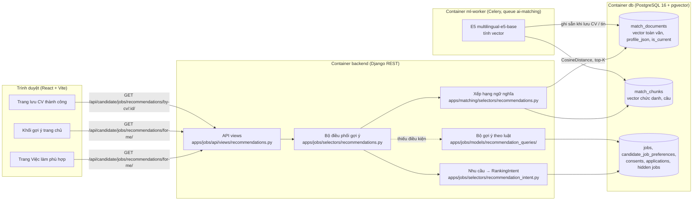
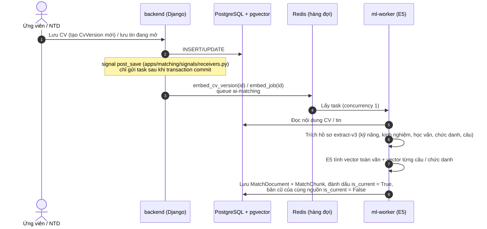
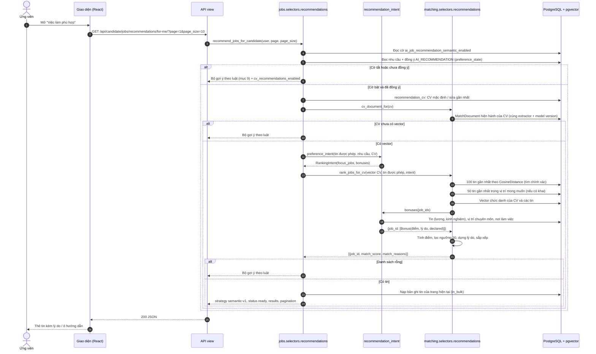
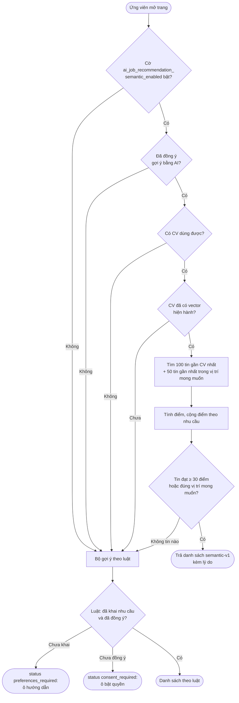
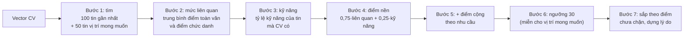
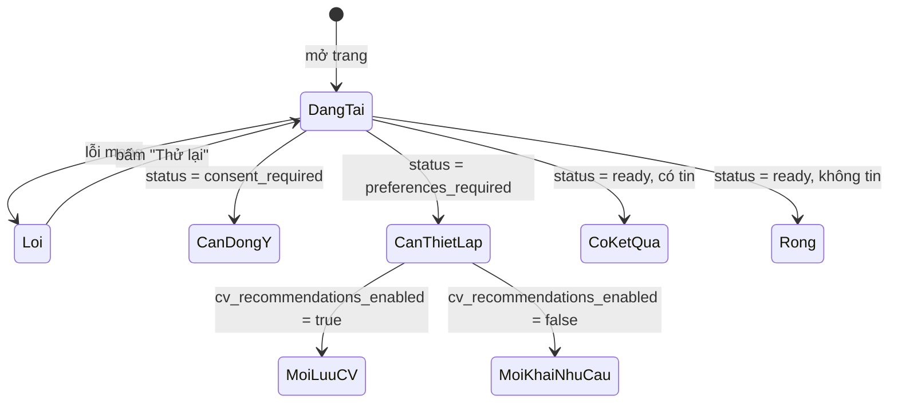

# Chức năng "Việc làm phù hợp" (gợi ý việc làm theo ngữ nghĩa)

Tài liệu giải thích trọn chức năng gợi ý việc làm cho ứng viên sau kế hoạch AI bản 3
(GĐ 4, PR #279): người dùng thấy gì, dữ liệu đi đâu, thuật toán tính ra sao, khi nào
hệ thống quay về bộ gợi ý theo luật, và các con số đo được. Mọi tên hàm, tệp, hằng số
trong tài liệu khớp với mã ở nhánh `dev` ngày 20/11/2026.

Mục lục:

1. [Tóm tắt một trang](#1-tóm-tắt-một-trang)
2. [Người dùng thấy gì](#2-người-dùng-thấy-gì)
3. [Hai nguồn dữ liệu: CV và nhu cầu công việc](#3-hai-nguồn-dữ-liệu-cv-và-nhu-cầu-công-việc)
4. [Kiến trúc tổng thể](#4-kiến-trúc-tổng-thể)
5. [Bước chuẩn bị: tính sẵn vector](#5-bước-chuẩn-bị-tính-sẵn-vector)
6. [Luồng xử lý một lượt mở trang](#6-luồng-xử-lý-một-lượt-mở-trang)
7. [Thuật toán xếp hạng `semantic-v1`](#7-thuật-toán-xếp-hạng-semantic-v1)
8. [Lý do gợi ý hiển thị cho ứng viên](#8-lý-do-gợi-ý-hiển-thị-cho-ứng-viên)
9. [Đường dự phòng: bộ gợi ý theo luật](#9-đường-dự-phòng-bộ-gợi-ý-theo-luật)
10. [Hợp đồng API](#10-hợp-đồng-api)
11. [Trạng thái giao diện](#11-trạng-thái-giao-diện)
12. [Quyền riêng tư, công bằng, an toàn](#12-quyền-riêng-tư-công-bằng-an-toàn)
13. [Hiệu năng](#13-hiệu-năng)
14. [Đánh giá bằng số liệu](#14-đánh-giá-bằng-số-liệu)
15. [Giới hạn và hướng phát triển](#15-giới-hạn-và-hướng-phát-triển)
16. [Vận hành và bản đồ mã nguồn](#16-vận-hành-và-bản-đồ-mã-nguồn)
17. [Câu hỏi thường gặp](#17-câu-hỏi-thường-gặp)

---

## 1. Tóm tắt một trang

**Mục tiêu.** Đưa cho ứng viên danh sách tin tuyển dụng đang mở phù hợp nhất với mình,
kèm lý do bằng lời, mà không bắt ứng viên khai báo gì trước nếu đã có CV.

**Ý tưởng chính.**

- **CV kể quá khứ** (đã làm gì, giỏi gì). Hệ thống đọc **ý nghĩa** nội dung CV bằng mô
  hình ngôn ngữ E5 và so với ý nghĩa nội dung từng tin. Hai văn bản nói cùng một việc
  bằng chữ khác nhau ("xây dựng trang thanh toán bằng ReactJS" và "Frontend Developer")
  vẫn được coi là gần nhau.
- **Nhu cầu công việc nói tương lai** (muốn làm vị trí gì, ở đâu, lương bao nhiêu).
  Nhu cầu không bắt buộc, nhưng khi có thì nó **lái** thứ hạng. Tin đúng vị trí mong
  muốn luôn được xét và được đẩy lên, để người muốn đổi nghề không chỉ nhận tin giống
  công việc cũ.

**Cách chạy, ba bước.**

1. **Lúc lưu CV hay đăng tin:** mô hình E5 trong container `ml-worker` đổi nội dung
   thành vector 768 số và lưu vào PostgreSQL (pgvector).
2. **Lúc ứng viên mở trang:** máy chủ web không nạp mô hình. Nó chỉ nhờ CSDL tìm các
   tin có vector gần vector CV nhất.
3. **Xếp lại các tin tìm được** theo công thức:

   ```
   điểm = 0,75 · mức liên quan + 0,25 · tỷ lệ kỹ năng trùng + điểm cộng theo nhu cầu
   ```

   Tin dưới 30 điểm bị bỏ, trừ tin đúng vị trí ứng viên mong muốn. Kết quả trả về kèm
   lý do, **không kèm điểm số**.

**Khi không làm theo ngữ nghĩa được** (cờ tắt, chưa có CV, CV chưa có vector, không tin
nào đủ gần), hệ thống quay về bộ gợi ý theo luật cũ, như trước GĐ 4.

**Khi ứng viên tắt "Gợi ý việc làm"** (có popup xác nhận), trang vẫn có danh sách nhưng
**không đọc CV**: xếp theo nhu cầu đã khai, hoặc tin mới nhất nếu chưa khai (`latest-v1`).
Trang hiện khung "Gợi ý việc làm đang tắt" kèm nút bật lại (cũng qua popup đồng ý).

---

## 2. Người dùng thấy gì

Chức năng xuất hiện ở ba chỗ, cùng dùng một bộ xếp hạng:

| Chỗ | Đường dẫn | Nội dung |
| --- | --- | --- |
| Trang "Việc làm phù hợp" | `/tai-khoan/viec-lam-phu-hop` | Danh sách đầy đủ, 10 tin mỗi trang, có phân trang |
| Khối "Gợi ý việc làm phù hợp" ở trang chủ | `/` | 8 tin đầu, xoay 4 tin mỗi lượt |
| Trang "Lưu CV thành công" | `/save-cv-success/:publicId` | 6 tin hợp với **chính CV vừa lưu** |

Mỗi thẻ tin hiện:

- thông tin tin như danh sách việc làm (tên, công ty, lương, nơi làm, hạn);
- **các nhãn lý do**, ví dụ "Đúng vị trí bạn mong muốn", "Trùng kỹ năng: ReactJS,
  TypeScript", "Vị trí gần với CV của bạn";
- nút ẩn tin (tin đã ẩn không bao giờ được gợi ý lại).

Không hiện phần trăm hay điểm. Con số duy nhất ứng viên thấy là điểm của chức năng
"Xem độ phù hợp" trên trang chi tiết tin, để hai con số không bao giờ mâu thuẫn nhau.

Các tin chèn giữa danh sách việc làm và email "việc làm mới phù hợp" **không** thuộc
chức năng này. Hai chỗ đó vẫn chạy theo luật (mục 9).

---

## 3. Hai nguồn dữ liệu: CV và nhu cầu công việc

### 3.1 CV dùng để gợi ý

Hàm `recommendation_cv` (`apps/matching/selectors/recommendations.py`) chọn **một** CV:

- **Trang lưu CV thành công:** đúng CV vừa lưu.
- **Trang "Việc làm phù hợp" và trang chủ:**
  - CV mặc định;
  - nếu không có CV mặc định thì CV sửa gần nhất.

Bị loại:

- CV đã xóa, bị khóa kiểm duyệt hoặc lưu trữ;
- bản mẫu của CV builder mà ứng viên chưa bấm Lưu.

Thứ dùng từ CV là **hồ sơ đối sánh** đã tính sẵn của phiên bản mới nhất (`MatchDocument`):

| Thành phần | Dùng để |
| --- | --- |
| Vector toàn văn (768 chiều) | Tìm tin gần nhất, tính điểm toàn văn |
| Vector chức danh (chunk `title`) | Tính điểm chức danh |
| Danh sách kỹ năng `counted` trong `profile_json` | Tính tỷ lệ kỹ năng trùng, lý do "Trùng kỹ năng" |
| `experience_years` của CV | Điểm cộng kinh nghiệm (nếu CV có; không thì lấy theo khai báo) |

### 3.2 Nhu cầu công việc (không bắt buộc)

Ứng viên khai ở `/tai-khoan/cai-dat-goi-y-viec-lam` hoặc màn hình `/onboard-user`. Bảng
dưới ghi trường nào được dùng ở đâu:

| Trường nhu cầu | Gợi ý theo ngữ nghĩa (`semantic-v1`) | Gợi ý theo luật |
| --- | --- | --- |
| Vị trí chuyên môn mong muốn (tối đa 5) | **Luôn xét** tin thuộc vị trí đó, **+0,40**, không bị ngưỡng cắt | +38 điểm |
| Vị trí tự nhập | Như trên, khớp khi tiêu đề tin chứa tên vị trí | Khớp tiêu đề +24 |
| Tỉnh mong muốn | +0,05 | +10 |
| Mức lương mong muốn | +0,03 nếu lương tin trong khoảng 80–125% mức mong muốn | +8 |
| Số năm kinh nghiệm | +0,03 nếu đủ yêu cầu và không vượt quá 2 bậc | +6 |
| Kỹ năng quan tâm | Không dùng (kỹ năng lấy từ CV) | +6 mỗi kỹ năng, tối đa 24 |
| Sẵn sàng chuyển nơi ở | Không dùng | +3 |

Điểm của hai bộ khác thang đo (0–1 so với 0–100), nhưng thứ tự ưu tiên giống nhau: vị
trí mong muốn nặng nhất, các tín hiệu còn lại nhẹ.

**Vì sao nhu cầu vẫn cần dù CV đã đủ để gợi ý.** Ví dụ một người làm kế toán 3 năm,
đang học phân tích dữ liệu, khai vị trí mong muốn "Data Analyst":

- **Chỉ theo CV:** gần như toàn tin kế toán, đúng thứ họ muốn rời đi.
- **Có nhu cầu:** tin Data Analyst được đưa vào và xếp lên đầu. Giữa các tin Data
  Analyst, tin nào cần kỹ năng CV đã có (Excel, SQL) đứng trước.

---

## 4. Kiến trúc tổng thể



Ba điểm thiết kế quan trọng:

- **Mô hình không chạy khi mở trang.**
  - Mô hình E5 (khoảng 1 GB) chỉ nằm trong `ml-worker`.
  - Tiến trình web chỉ so các vector đã lưu, nên không cần torch, phản hồi nhanh và ổn định.
- **Ranh giới giữa hai app** (theo ADR-0022):
  - App `matching` không đọc bảng nhu cầu của ứng viên.
  - App `jobs` đọc nhu cầu và dựng một đối tượng `RankingIntent`. Đối tượng này mang tập
    tin thuộc vị trí mong muốn (`focus_jobs`) và hàm tính điểm cộng (`bonuses`), rồi được
    truyền sang `matching`.
- **Bộ gợi ý theo luật không bị bỏ:**
  - Nó là đường dự phòng.
  - Nó vẫn phục vụ email gợi ý và tin chèn trong danh sách việc làm.

---

## 5. Bước chuẩn bị: tính sẵn vector

Vector được tính khi dữ liệu thay đổi, không phải khi ứng viên mở trang.



Chi tiết:

- **Điều kiện gửi task:**
  - cờ `ai_job_match_enabled` bật và biến môi trường `MATCHING_PRECOMPUTE_ENABLED` bật;
  - CV phải là phiên bản mới (`created`);
  - tin phải đang `active`, và chỉ khi đổi các trường ảnh hưởng hồ sơ: tiêu đề, mô tả,
    yêu cầu, trạng thái, kinh nghiệm, học vấn, cấp bậc.
- **Khóa nhận diện** của một hồ sơ gồm: nguồn, hash nội dung, phiên bản trích xuất
  (`extract-v3`) và phiên bản mô hình (`e5-base-zs-v1`). Nội dung không đổi thì dùng lại
  bản cũ, không tính lại.
- **`is_current`** (migration `matching.0002`) cho biết bản nào là bản hiện hành:
  - mỗi CV và mỗi tin chỉ có đúng một bản hiện hành, nhờ ràng buộc duy nhất có điều kiện;
  - tìm kiếm chỉ xét bản hiện hành, nên không ra tin trùng hay nội dung cũ.
- **Hệ quả khi `ml-worker` tắt:** CV vừa lưu chưa có vector, nên trang tạm dùng bộ gợi ý
  theo luật cho tới khi vector được tính.

---

## 6. Luồng xử lý một lượt mở trang

### 6.1 Sơ đồ tuần tự



"Tin được phép" là kết quả của `recommendable_jobs(user)`: tin đang công khai, trừ tin
ứng viên đã ứng tuyển và tin ứng viên đã ẩn.

### 6.2 Sơ đồ quyết định



---

## 7. Thuật toán xếp hạng `semantic-v1`

Toàn bộ nằm trong `rank_jobs_for_cv` (`apps/matching/selectors/recommendations.py`), cộng
phần điểm cộng ở `apps/jobs/selectors/recommendation_intent.py`.



### Bước 1: tìm ứng viên tin (retrieval)

- So vector toàn văn của CV với vector toàn văn của mọi tin được phép, bằng **khoảng cách
  cosine** của pgvector (`CosineDistance`), rồi lấy `SEMANTIC_POOL = 100` tin gần nhất.
- Nếu ứng viên khai vị trí mong muốn, lấy thêm `FOCUS_POOL = 50` tin gần CV nhất **trong
  các tin thuộc vị trí đó**. Tin trùng với 100 tin trên chỉ tính một lần.
- **Tìm chính xác** (quét hết), không dùng chỉ mục xấp xỉ HNSW:
  - với vài trăm đến vài nghìn tin, quét hết vẫn nhanh;
  - kết quả đúng 100%;
  - mỗi lần chạy ra cùng một kết quả.

> Cosine đo góc giữa hai vector: 1 là cùng hướng (nội dung rất giống), càng nhỏ càng
> khác. Với E5, mọi cặp văn bản đều có cosine khá cao (khoảng 0,80–0,92), nên phải hiệu
> chuẩn ở bước 2.

### Bước 2: mức liên quan

Cosine được quy đổi thành điểm 0–100 bằng **mốc hiệu chuẩn** của đúng phiên bản mô hình
(`apps/matching/domain/calibration.py`):

```
điểm = clip((cosine − low) / (high − low), 0, 1) × 100
```

| Phép so | `low` (→ 0 điểm) | `high` (→ 100 điểm) | Ý nghĩa mốc |
| --- | ---: | ---: | --- |
| Toàn văn CV ↔ toàn văn tin | 0,817 | 0,889 | `low` = trung vị cặp khác ngành, `high` = phân vị 90 cặp khớp mạnh |
| Chức danh CV ↔ chức danh tin | 0,807 | 0,918 | như trên, cho chức danh |

Đây là mốc của `e5-base-zs-v1`. Chức năng "Xem độ phù hợp" dùng **cùng mốc**, nên hai
chức năng hiểu "gần" theo cùng một nghĩa.

```
mức liên quan = trung bình(điểm toàn văn, điểm chức danh)   (thiếu chức danh thì chỉ điểm toàn văn)
```

### Bước 3: kỹ năng

```
tỷ lệ kỹ năng = số kỹ năng của tin mà CV có / số kỹ năng của tin
```

- Chỉ tính kỹ năng `counted`. Phẩm chất như "chăm chỉ" hay "chịu áp lực" không tính.
- So theo **mã kỹ năng trong danh mục**, nên "ReactJS" và "React.js" là cùng một kỹ năng
  nhờ bảng alias.
- Tin không có kỹ năng nào thì điểm nền chỉ là mức liên quan.

### Bước 4: điểm nền

```
điểm nền = 0,75 · mức liên quan + 0,25 · tỷ lệ kỹ năng
```

Mức liên quan nặng hơn, vì nó bắt được những gì kỹ năng không bắt được: lĩnh vực, loại
công việc, cách mô tả kinh nghiệm.

### Bước 5: điểm cộng theo nhu cầu

| Điểm cộng | Điều kiện | Lý do hiển thị | Bị ngưỡng cắt? |
| --- | --- | --- | --- |
| +0,40 | Tin có vị trí chuyên môn chính nằm trong danh sách mong muốn, hoặc tiêu đề chứa vị trí tự nhập | "Đúng vị trí bạn mong muốn" (đứng đầu) | **Không** |
| +0,05 | Một nơi làm việc của tin thuộc tỉnh mong muốn | "Đúng nơi làm việc bạn mong muốn" | Có |
| +0,03 | Lương VND của tin chạm khoảng 80–125% mức mong muốn (tin "thỏa thuận" không tính) | "Mức lương hợp mong muốn của bạn" | Có |
| +0,03 | Số năm kinh nghiệm của ứng viên đủ yêu cầu và không vượt quá 2 bậc (người trên 5 năm không được cộng cho tin không yêu cầu kinh nghiệm) | "Số năm kinh nghiệm vừa với tin" | Có |

Bậc kinh nghiệm theo thứ tự: không yêu cầu, dưới 1 năm, 1, 2, 3, 4, 5, trên 5 năm. Số
năm của ứng viên lấy từ CV nếu CV có, không thì lấy theo khai báo.

### Bước 6: ngưỡng

```
match_score = làm tròn(min(1, điểm nền + điểm cộng) × 100)
```

- Bỏ tin có `match_score < 30` (`MIN_SEMANTIC_SCORE`).
- **Ngoại lệ:** tin đúng vị trí mong muốn không bị bỏ. CV của người đổi nghề tất nhiên
  xa tin của nghề mới, và chính ứng viên đã nói muốn làm vị trí đó.
- **Vì sao 30:** đo trên 100 CV tổng hợp, ngưỡng 35 cắt khoảng 10% tin gốc của CV khớp
  mạnh và để 5% CV không còn gợi ý nào.

### Bước 7: sắp xếp và lý do

- Sắp theo **điểm chưa chặn** (điểm nền + điểm cộng, có thể vượt 1), hòa thì theo mã tin.
  Nếu sắp theo điểm đã chặn ở 100, nhiều tin cùng chạm trần sẽ mất thứ tự theo mức liên
  quan. Lỗi này đã được sửa ở PR #279.
- Dựng lý do (mục 8).
- Kết quả gồm `job_id`, `match_score`, `match_reasons` và `match_details` (luôn rỗng ở chiến
  lược này).

### Ví dụ tính tay

Số liệu dưới là **minh họa**, dùng đúng mốc hiệu chuẩn và hệ số của hệ thống.

**Ví dụ A: ứng viên Frontend, tin Frontend ở Hà Nội, đã khai tỉnh Hà Nội.**

| Đại lượng | Giá trị | Tính |
| --- | ---: | --- |
| Cosine toàn văn | 0,865 | |
| Điểm toàn văn | 66,7 | (0,865 − 0,817) / 0,072 × 100 |
| Cosine chức danh | 0,880 | |
| Điểm chức danh | 65,8 | (0,880 − 0,807) / 0,111 × 100 |
| Mức liên quan | 0,662 | (0,667 + 0,658) / 2 |
| Kỹ năng | 3/4 = 0,75 | Tin cần ReactJS, TypeScript, Redux, Jest; CV có ba cái đầu |
| Điểm nền | 0,684 | 0,75 × 0,662 + 0,25 × 0,75 |
| Điểm cộng tỉnh | +0,05 | |
| **match_score** | **73** | |

Lý do: "Trùng kỹ năng: ReactJS, TypeScript, Redux", "Vị trí gần với CV của bạn" (điểm
chức danh ≥ 60), "Kinh nghiệm trong CV gần với yêu cầu của tin" (điểm toàn văn ≥ 60),
"Đúng nơi làm việc bạn mong muốn".

**Ví dụ B: CV kế toán, tin Data Analyst, ứng viên đã khai vị trí mong muốn "Data Analyst".**

| Đại lượng | Giá trị |
| --- | ---: |
| Điểm toàn văn (cosine 0,830) | 18,1 |
| Điểm chức danh (cosine 0,810) | 2,7 |
| Mức liên quan | 0,104 |
| Kỹ năng | 1/5 = 0,20 (Excel) |
| Điểm nền | 0,128 → 13 điểm |
| Không khai vị trí | 13 < 30, **bị bỏ** |
| Có khai vị trí: +0,40 | **53**, được giữ, lý do đầu "Đúng vị trí bạn mong muốn" |

### Vì sao chọn +0,40

Mô phỏng trên 100 CV tổng hợp × 100 tin thật (`ml/scripts/evaluate_recommendations.py
--intent-study`). Hai kịch bản:

- **Khai đúng nghề cũ:** mỗi CV khai đúng vị trí nó được viết.
- **Đổi nghề:** mỗi CV khai một vị trí khác, chọn ngẫu nhiên cố định trong các vị trí có
  ít nhất 3 tin.

| Điểm cộng | Khai đúng nghề cũ: MRR tin gốc | NDCG@10 cùng vị trí | Đổi nghề: tin nghề mới trong top 10 | NDCG@10 nghề mới | Tin nghề cũ còn trong top 10 |
| --- | ---: | ---: | ---: | ---: | ---: |
| Không khai | 0,776 | 0,832 | 3% | 0,043 | 25% |
| +0,10 | 0,823 | 0,915 | 9% | 0,137 | 24% |
| +0,20 | 0,826 | 0,961 | 20% | 0,326 | 24% |
| +0,30 | 0,829 | 0,984 | 29% | 0,535 | 24% |
| **+0,40** | **0,829** | **0,998** | **34%** | **0,719** | **23%** |
| +0,50 | 0,829 | 1,000 | 36% | 0,829 | 22% |

Cách đọc: mỗi nghề chỉ có trung bình khoảng 3,6 tin trong 100 tin thật, nên "tin nghề
mới trong top 10" có trần là 36%. Ở +0,40, hầu hết tin nghề mới đã lên top 10, mà ứng
viên vẫn thấy khoảng 2 tin của nghề cũ. Lên +0,50 thì tin nghề cũ bắt đầu bị đẩy ra.
Không mức nào làm tụt tin gốc của CV khi ứng viên khai đúng nghề cũ.

---

## 8. Lý do gợi ý hiển thị cho ứng viên

| Lý do | Điều kiện | Nguồn |
| --- | --- | --- |
| Đúng vị trí bạn mong muốn | Tin thuộc vị trí mong muốn đã khai (luôn đứng đầu) | Nhu cầu |
| Trùng kỹ năng: A, B, C | Có kỹ năng trùng; liệt kê tối đa 3 | CV |
| Vị trí gần với CV của bạn | Điểm chức danh ≥ 60 | CV |
| Kinh nghiệm trong CV gần với yêu cầu của tin | Điểm toàn văn ≥ 60 | CV |
| Đúng nơi làm việc bạn mong muốn | Điểm cộng tỉnh | Nhu cầu |
| Mức lương hợp mong muốn của bạn | Điểm cộng lương | Nhu cầu |
| Số năm kinh nghiệm vừa với tin | Điểm cộng kinh nghiệm | CV / nhu cầu |
| Nội dung CV gần với tin này | Không có lý do nào ở trên | CV |

Mọi lý do đều có bản tiếng Anh (catalog `apps/jobs/locale/en`, `apps/matching/locale/en`).

---

## 9. Đường dự phòng: bộ gợi ý theo luật

Bộ luật `candidate-preference-rule-v2` / `profile-rule-v2` chạy trong các trường hợp:

- cờ `ai_job_recommendation_semantic_enabled` tắt;
- ứng viên chưa đồng ý gợi ý bằng AI;
- chưa có CV dùng được, hoặc CV chưa có vector;
- không tin nào qua ngưỡng;
- luôn luôn với email "việc làm mới phù hợp" và tin chèn trong danh sách việc làm.

Bộ luật cộng điểm theo tín hiệu khai báo (chi tiết ở `candidate-job-recommendations.md`):

| Tín hiệu | Điểm |
| --- | ---: |
| Đúng vị trí chuyên môn mong muốn | 38 |
| Chức danh xuất hiện trong tiêu đề tin | 24 |
| Mỗi kỹ năng trùng tên | 6 (tối đa 24) |
| Đúng tỉnh mong muốn | 10 |
| Mức lương khớp | 8 |
| Đủ số năm kinh nghiệm | 6 |
| Sẵn sàng chuyển nơi ở | 3 |

Ngưỡng của bộ luật là 20 điểm. Trang "Việc làm phù hợp" theo luật **bắt buộc** ứng viên
đã khai nhu cầu. Chưa khai thì API trả `status: preferences_required`.

**Khác biệt cốt lõi:** luật chỉ thấy cái gì **trùng tên**. CV viết "Pivot, XLOOKUP" mà
tin ghi "Excel nâng cao" thì luật không nhận ra, vector thì có.

---

## 10. Hợp đồng API

### 10.1 Danh sách cho tài khoản

`GET /api/candidate/jobs/recommendations/for-me/?page=1&page_size=10`

- Chỉ tài khoản ứng viên được gọi.
- `page_size` từ 1 đến 20.

```json
{
  "status": "ready",
  "strategy": "semantic-v1",
  "minimum_match_score": 30,
  "preference_configured": false,
  "cv_recommendations_enabled": true,
  "needs_setup": false,
  "consent_required": false,
  "sources": { "job_preferences": false, "cv": true, "search_activity": false },
  "source_cv": { "public_id": "cv_ab12", "title": "CV Frontend", "is_default": true },
  "focus_keyword": "Frontend Developer",
  "related_positions": [],
  "results": [
    {
      "public_id": "jb_9f2c",
      "slug": "frontend-developer-reactjs",
      "title": "Frontend Developer (ReactJS)",
      "match_score": 73,
      "match_details": [],
      "match_reasons": [
        "Trùng kỹ năng: ReactJS, TypeScript, Redux",
        "Vị trí gần với CV của bạn",
        "Đúng nơi làm việc bạn mong muốn"
      ]
    }
  ],
  "pagination": {
    "page": 1, "page_size": 10, "total": 37, "total_pages": 4,
    "next_page": 2, "previous_page": null
  }
}
```

| Trường | Ý nghĩa |
| --- | --- |
| `status` | `ready`, `preferences_required` hoặc `consent_required` |
| `strategy` | `semantic-v1` (ngữ nghĩa) hoặc `candidate-preference-rule-v2` (luật) |
| `preference_configured` | Ứng viên đã khai nhu cầu chưa |
| `cv_recommendations_enabled` | Cờ gợi ý theo CV đang bật. Giao diện dùng để chọn lời hướng dẫn |
| `source_cv` | CV được dùng để gợi ý |
| `results[].match_score` | Còn trong API để tương thích; **giao diện không hiển thị** |
| `results[].match_reasons` | Lý do bằng lời, theo thứ tự hiển thị |

Mỗi phần tử của `results` có đủ các trường của danh sách việc làm công khai
(`PublicJobListSerializer`).

### 10.2 Gợi ý cho một CV

`GET /api/candidate/jobs/recommendations/by-cv/<cv_public_id>/`

- Trả 6 tin cho trang lưu CV thành công.
- CV không thuộc người gọi thì trả 404.
- Cùng thuật toán và cùng nhu cầu, chỉ khác là dùng đúng CV được chỉ định.

---

## 11. Trạng thái giao diện

Widget `frontend/src/widgets/main/candidate-job-recommendations/`:



| Trạng thái | Hiển thị |
| --- | --- |
| Đang tải | 3 khung xương (Skeleton) |
| `ready`, `ai_recommendation_enabled = false` | Khung vàng "Gợi ý việc làm đang tắt" + nút "Bật gợi ý việc làm" (popup đồng ý); danh sách theo nhu cầu hoặc tin mới nhất, không có "Vì sao phù hợp?" khi là tin mới nhất |
| `consent_required` | (Không còn trả cho trang này; giữ cho tương thích) "Bật quyền gợi ý việc làm" |
| `preferences_required`, gợi ý theo CV bật | "Lưu CV hoặc khai nhu cầu công việc", nút cài đặt và liên kết "Quản lý CV" |
| `preferences_required`, gợi ý theo CV tắt | "Hoàn thiện nhu cầu công việc" và nút cài đặt |
| `ready` có tin | "Tìm thấy N việc làm phù hợp với yêu cầu của bạn.", thẻ tin (logo, tên, lương, nơi làm "Hà Nội & 2 nơi khác", "Vì sao phù hợp?" liệt kê lý do, ngày đăng, "Ứng tuyển", ẩn, lưu), phân trang |
| `ready`, chưa khai nhu cầu | Như trên; liên kết cài đặt ghi "Thêm nhu cầu để gợi ý sát hơn" |
| `ready` rỗng | "Chưa có việc làm đủ phù hợp", lời mời cập nhật CV hoặc nhu cầu |

Khối ở trang chủ hiện với mọi ứng viên đã đăng nhập; trước GĐ 4 nó chỉ hiện với người đã
khai nhu cầu. Nếu kết quả không phải `ready` hoặc rỗng, khối ẩn hẳn.

Chuỗi giao diện mới nằm ở vùng i18n `frontend/messages/candidate/{vi,en}.json` (khóa
`candidate_reco_*`). Thanh nhắc trên đầu trang mời: "Thêm vị trí, mức lương mong muốn để
gợi ý việc làm sát hướng bạn muốn hơn".

---

## 12. Quyền riêng tư, công bằng, an toàn

- **Đồng ý trước khi đọc:** hệ thống chỉ đọc CV để gợi ý sau khi ứng viên đồng ý
  `AI_RECOMMENDATION`. Ứng viên bật/tắt đồng ý này bằng công tắc "Gợi ý việc làm" ở thanh
  bên tài khoản (endpoint riêng `/api/candidate/ai-recommendation/`, không cần khai nhu
  cầu) hoặc trong form cài đặt gợi ý. Mỗi lần bật/tắt ghi một sự kiện kiểm toán
  (`CandidateConsentEvent`). Biểu tượng "?" cạnh công tắc giải thích chức năng và trỏ tới
  chính sách xử lý dữ liệu bằng AI (cài đặt quản trị `ai_data_policy_url`).
- **Không lộ điểm:** điểm chỉ dùng để sắp xếp. Ứng viên không thấy, nhà tuyển dụng không
  thấy.
- **Tin đã ứng tuyển hoặc đã ẩn không bao giờ được gợi ý**, nhờ lọc ngay trong truy vấn
  tìm kiếm.
- **Không dùng thuộc tính nhạy cảm:** vector được tính từ nội dung CV đã gỡ thông tin
  liên hệ (`scrub_contacts`). Câu yêu cầu về số đo cơ thể ("nữ cao từ 158cm") bị loại khỏi
  hồ sơ tin; luật này thuộc nhánh GĐ 3 `feat/ai-training`, chưa có ở `dev`.
- **Chạy hoàn toàn trên máy chủ của hệ thống:** không gọi API ngoài, không dùng mô hình
  ngôn ngữ lớn. Cùng đầu vào luôn cho cùng kết quả.

---

## 13. Hiệu năng

- **Số truy vấn cố định, không tăng theo số tin:**
  - tìm 100 tin gần nhất;
  - tìm trong vị trí mong muốn (nếu có khai);
  - vector chức danh;
  - ba truy vấn của điểm cộng (tin, vị trí, nơi làm việc);
  - nạp bản ghi tin của trang hiện tại.

  Test `test_query_count_does_not_grow_with_the_number_of_jobs` khẳng định điều này.
- **Không nạp mô hình** trong tiến trình web.
- **Tìm chính xác** trên vài nghìn vector 768 chiều mất cỡ vài chục mili giây trong
  PostgreSQL. Chỉ mục HNSW để dành cho quy mô hàng chục nghìn tin (thực nghiệm chưa làm).

---

## 14. Đánh giá bằng số liệu

**Không có nhãn người cho chiều CV → tin.** Tập vàng 300 cặp chấm theo chiều "một tin,
10 CV". Vì vậy gợi ý được đo bằng **nhãn yếu**:

- mỗi CV tổng hợp được viết từ một tin gốc, nên tin gốc phải đứng đầu;
- các tin cùng vị trí chuyên môn được coi là gợi ý đúng.

Gọi là "yếu" vì không ai chấm tay.

| Phương án | Tin gốc ở hạng 1 | Trong top 10 | MRR | Precision@5 cùng vị trí | NDCG@10 cùng vị trí |
| --- | ---: | ---: | ---: | ---: | ---: |
| BM25 (so từ) | 0,350 | 0,613 | 0,443 | 0,270 | 0,538 |
| Luật `profile-rule-v2` | 0,675 | 0,975 | 0,795 | 0,362 | 0,726 |
| `semantic-v1` (e5-base gốc, chưa khai nhu cầu) | 0,650 | 0,975 | 0,780 | 0,430 | 0,830 |
| `semantic-v1` + khai đúng vị trí | 0,688 | — | 0,829 | — | 0,998 |

- **Tìm đúng tin gốc:** ngữ nghĩa ngang luật.
- **Gợi ý thêm các tin cùng nghề:** ngữ nghĩa hơn rõ, mà đó mới là việc chính của trang.
- **Khi ứng viên khai vị trí:** ngữ nghĩa hơn luật ở mọi số đo.
- Báo cáo đầy đủ ở `ml/reports/recommendations.md`.

Kiểm thử tự động (`apps/matching/tests/test_recommendations.py`):

- **TC-18:** gợi ý theo CV, chỉ trả lý do, không cần khai nhu cầu.
- **TC-19:** CV chưa có vector, hoặc không tin nào đủ gần, thì dùng luật.
- **TC-20:** chưa đồng ý thì không xếp theo ngữ nghĩa.
- **TC-21:** không gợi ý tin đã ứng tuyển hoặc đã ẩn.
- **TC-22:** tắt cờ thì dùng luật.
- **Thêm ở PR #279:**
  - đổi nghề theo vị trí chuyên môn;
  - vị trí tự nhập;
  - lý do lương và kinh nghiệm không lọc tin;
  - dải kinh nghiệm;
  - số truy vấn khi có nhu cầu.

---

## 15. Giới hạn và hướng phát triển

**Giới hạn hiện tại:**

- **Nhãn yếu và CV tổng hợp:** CV do mô hình ngôn ngữ viết từ chính tin gốc nên dễ trùng
  từ hơn CV thật. Con số dùng để so sánh các phương án, không phải chất lượng tuyệt đối.
- **Mô hình chưa fine-tune:** đang dùng mô hình gốc `e5-base-zs-v1`. Khi GĐ 3 có bản
  fine-tune đạt quy tắc chọn, chỉ cần đổi phiên bản mô hình và tính lại vector.
- **Thiếu vector khi `ml-worker` dừng:** CV mới lưu chưa có vector, trang tạm dùng luật.
- **Một CV mỗi lượt:** dùng CV mặc định, không gộp nhiều CV.
- **Nhu cầu dùng chưa hết:** "kỹ năng quan tâm" và "sẵn sàng chuyển nơi" chưa vào bộ ngữ
  nghĩa.

**Hướng tiếp (theo kế hoạch bản 3):**

- **GĐ 3:** bi-encoder fine-tune `e5-base-ft-v1`, vector tốt hơn cho cả gợi ý.
- **GĐ 5:** `hybrid-v2` với cross-encoder cho "Xem độ phù hợp"; gợi ý vẫn không cần
  cross-encoder.
- **Mở rộng:** thực nghiệm chỉ mục HNSW trên 48 nghìn tin VietJobs (độ trễ, recall@10 so
  với quét chính xác).

---

## 16. Vận hành và bản đồ mã nguồn

### 16.1 Bật, tắt, kiểm tra

| Việc | Cách làm |
| --- | --- |
| Bật/tắt gợi ý theo ngữ nghĩa | Cài đặt hệ thống `ai_job_recommendation_semantic_enabled` (trang quản trị) |
| Liên kết chính sách dữ liệu AI ở chú thích "?" | Cài đặt hệ thống `ai_data_policy_url` (để trống thì không hiện liên kết) |
| Tạo cài đặt trên DB mới | `docker compose exec backend python manage.py seed_sitecontent` (chỉ tạo khóa còn thiếu) |
| Bật tính sẵn vector | Cờ `ai_job_match_enabled` + env `MATCHING_PRECOMPUTE_ENABLED`, container `ml-worker` chạy |
| Tính lại vector cho dữ liệu cũ | `docker compose exec ml-worker python manage.py matching_backfill` |
| Đo lại | `ml/.venv/bin/python ml/scripts/evaluate_recommendations.py --intent-study` |

### 16.2 Bản đồ mã nguồn

| Tầng | Tệp | Vai trò |
| --- | --- | --- |
| API | `backend/apps/jobs/api/views/recommendations.py`, `api/serializers/recommendations.py` | Endpoint, hợp đồng JSON |
| Điều phối | `backend/apps/jobs/selectors/recommendations.py` | Kiểm điều kiện, chọn ngữ nghĩa hay luật, phân trang |
| Nhu cầu | `backend/apps/jobs/selectors/recommendation_intent.py` | `ranking_intent`, `preference_intent`, mức cộng |
| Xếp hạng | `backend/apps/matching/selectors/recommendations.py` | `recommendation_cv`, `cv_document_for`, `rank_jobs_for_cv`, `RankingIntent`, `Bonus` |
| Hiệu chuẩn | `backend/apps/matching/domain/calibration.py`, `domain/versions.py` | Mốc cosine, phiên bản trích xuất/mô hình |
| Lưu vector | `backend/apps/matching/services/documents.py`, `models/documents.py` | `MatchDocument`, `MatchChunk`, `is_current` |
| Tính sẵn | `backend/apps/matching/signals/receivers.py`, `tasks/analysis.py` | Signal, task `embed_cv_version`, `embed_job` |
| Luật | `backend/apps/jobs/models/recommendation_queries/` | Bộ gợi ý theo luật, `salary_fits`, `recommendable_jobs` |
| Giao diện | `frontend/src/widgets/main/candidate-job-recommendations/` | Trang, khối trang chủ, `SetupState`, thẻ tin |
| Trang lưu CV | `frontend/src/widgets/main/cv-save-success/` | Gợi ý cho CV vừa lưu |
| Đo | `backend/apps/matching/management/commands/matching_evaluate_recommendations.py`, `ml/scripts/evaluate_recommendations.py` | Xuất thứ hạng, tính MRR, NDCG, mô phỏng nhu cầu |
| Test | `backend/apps/matching/tests/test_recommendations.py`, `frontend/src/pages/main/account/MatchingJobs.test.jsx` | TC-18…22 và các ca nhu cầu |
| Sơ đồ đặc tả | `docs/01-phan-tich/mo-hinh-hoa-yeu-cau/06-doi-sanh-va-goi-y/{tuan-tu,hoat-dong}/37_goi_y_ngu_nghia.*` | Sơ đồ tuần tự và hoạt động cho báo cáo |

---

## 17. Câu hỏi thường gặp

**Khai nhu cầu công việc để làm gì nếu CV đã đủ?**

1. Lái gợi ý về hướng muốn đi: vị trí mong muốn +0,40 và luôn được xét.
2. Tinh chỉnh thứ tự bằng tỉnh, lương, kinh nghiệm, mỗi tín hiệu kèm một lý do.
3. Là điều kiện của email "việc làm mới phù hợp" và tin chèn trong danh sách việc làm,
   vì hai chỗ đó vẫn theo luật.
4. Là đường dự phòng khi CV chưa có vector.

**Sao tôi không thấy danh sách mà thấy ô hướng dẫn?** Một trong các lý do sau:

- Chưa đồng ý gợi ý bằng AI: bật công tắc "Gợi ý việc làm" ở thanh bên tài khoản.
- Chưa có CV đã lưu và cũng chưa khai nhu cầu.
- CV vừa lưu chưa được tính vector (`ml-worker` đang dừng hoặc đang xếp hàng).
- Cờ gợi ý theo ngữ nghĩa đang tắt và chưa khai nhu cầu.

**Sửa CV xong, gợi ý có đổi không?** Có:

- Lưu CV tạo phiên bản mới, và `ml-worker` tính vector mới.
- Bản mới thành bản hiện hành, nên lượt mở trang sau dùng bản mới.
- Nếu nội dung quay về như cũ, hệ thống dùng lại vector cũ, không tính lại.

**Nhà tuyển dụng sửa tin thì sao?** Đổi tiêu đề, mô tả, yêu cầu, kinh nghiệm, học vấn
hay cấp bậc thì vector của tin được tính lại. Đổi các trường khác (ví dụ hạn nộp) thì
không cần tính lại.

**Có phải "AI" thật không hay chỉ so chữ?** Là so **ý nghĩa**:

- E5 là mô hình transformer đa ngôn ngữ, biểu diễn câu thành vector.
- Hai câu khác chữ nhưng cùng nghĩa, kể cả một câu tiếng Việt và một câu tiếng Anh, cho
  vector gần nhau.
- Đây là thứ giúp ngữ nghĩa hơn luật ở chỉ số NDCG@10 cùng vị trí (0,830 so với 0,726),
  và hơn hẳn so từ BM25 (0,538).
